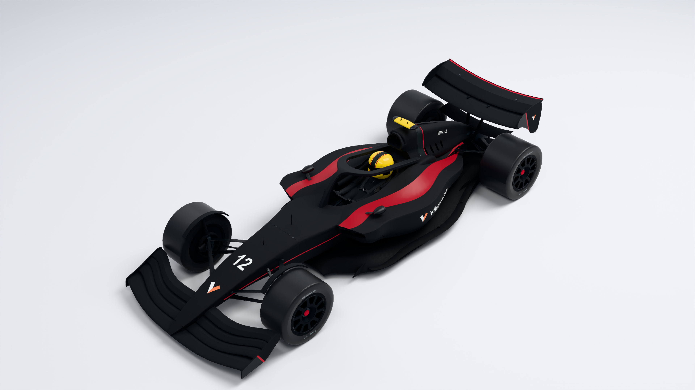
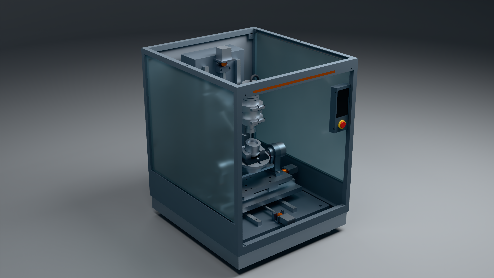
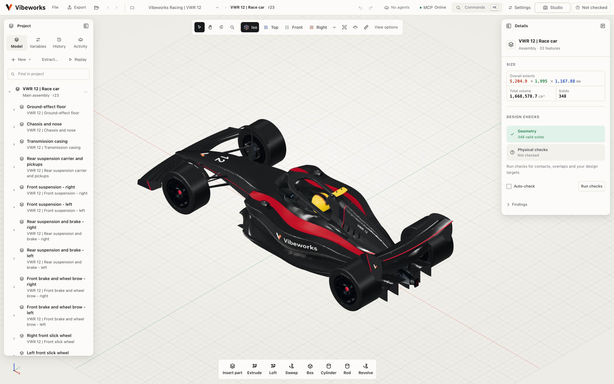
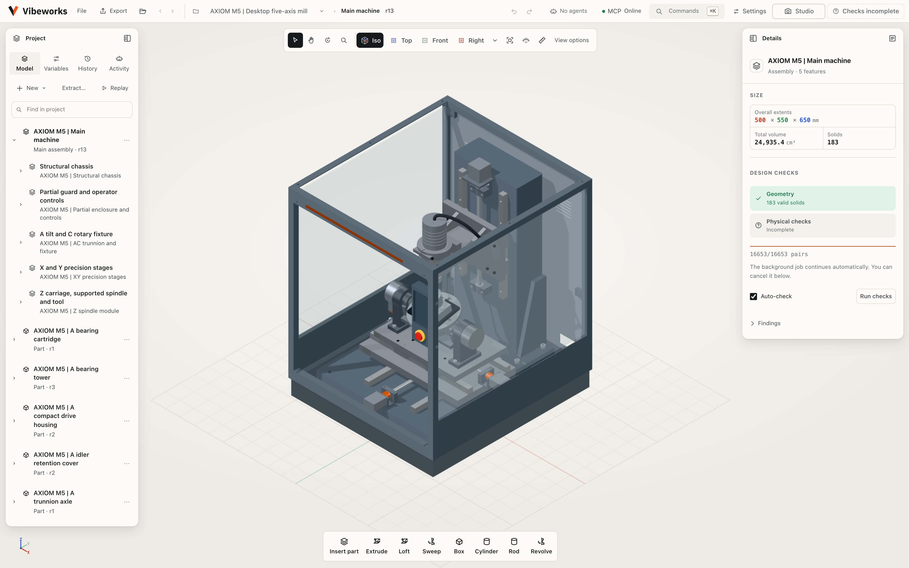
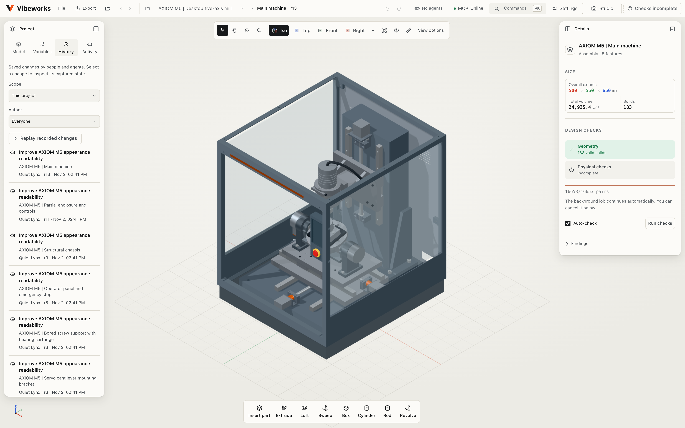
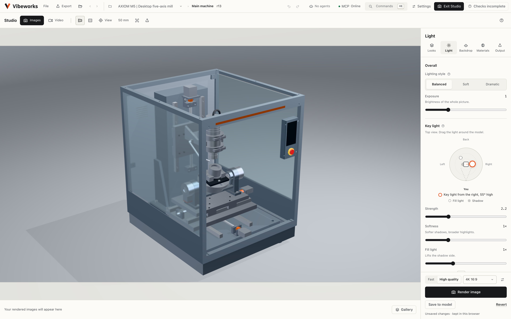
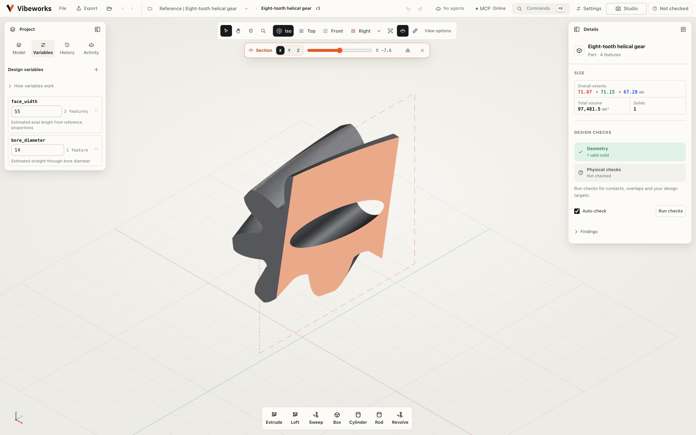
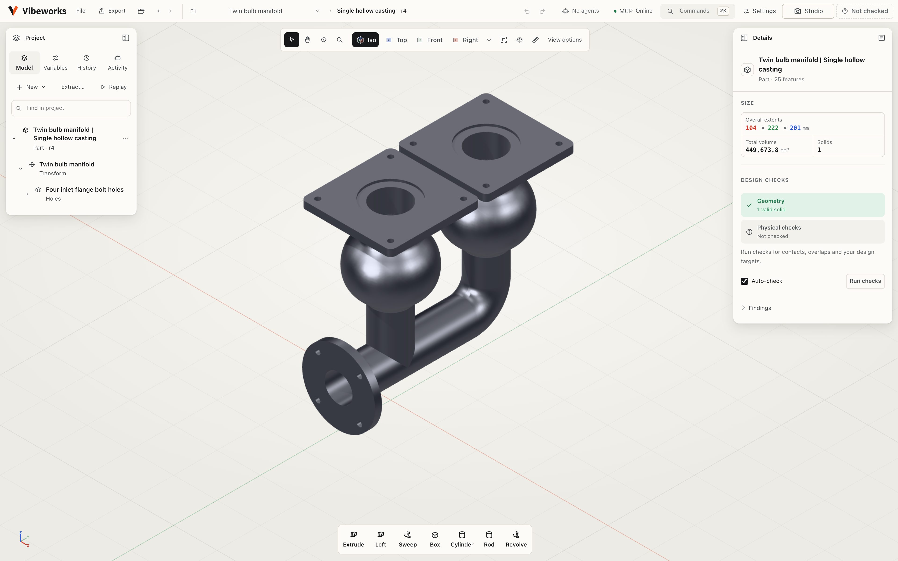

<p align="center">
  <picture>
    <source media="(prefers-color-scheme: dark)" srcset="public/brand/vibeworks-logo-dark.svg">
    
  </picture>
</p>

<p align="center">
  <strong>Agent-first CAD for mechanical design.</strong><br>
  Built from the ground up for agents, with human review in the loop.
</p>

<p align="center"><sub>Bring your own agent, connected through MCP.</sub></p>

<p align="center">
  <a href="https://openai.com/codex/">
    
  </a>
  &nbsp;&nbsp;&nbsp;
  <a href="https://code.claude.com/docs/en/overview">
    
  </a>
  &nbsp;&nbsp;&nbsp;
  <a href="https://docs.x.ai/build/overview">
    <picture>
      <source media="(prefers-color-scheme: dark)" srcset="docs/assets/agents/grok-dark.svg">
      
    </picture>
  </a>
  &nbsp;&nbsp;&nbsp;
  <a href="docs/mcp-setup.md">+&nbsp;other&nbsp;MCP&nbsp;agents</a>
</p>

<p align="center">
  <a href="#get-started">Get started</a> ·
  <a href="#connect-your-agent">Connect an agent</a> ·
  <a href="#made-with-vibeworks">Gallery</a> ·
  <a href="docs/architecture.md">Architecture</a> ·
  <a href="#where-this-is-going">Milestones</a> ·
  <a href="CONTRIBUTING.md">Contributing</a>
</p>

## Get started

You need Node.js 22.13 or newer and Make. Run `make` to see what each command does.

```sh
git clone https://github.com/farzinnasiri/vibeworks.git
cd vibeworks
make install            # Install the locked dependencies
make renderer-install   # Chromium for images and GLB; STEP/STL/JSON don't need it
make dev                # Start the modeling service and review workspace
```

Open <http://127.0.0.1:5173>. Leave the service running while you connect an agent in another terminal.
For modeling without a web UI, use `make headless` instead of `make dev`.

Portless is optional. If you already use it, `make dev-portless` serves the app at a named HTTPS URL.
The normal `make dev` command does not use or require it.

### Connect your agent

Install and sign in to your preferred coding agent first. Run one of these commands from the VibeWorks
checkout in a second terminal. Each starts a regular interactive session with the local CAD tools enabled.

#### Codex

```sh
vw_root="$(pwd -P)"
vw_node="$(command -v node)"
codex -C "$vw_root" \
  -c "mcp_servers.cad.command=\"$vw_node\"" \
  -c "mcp_servers.cad.args=[\"--import\",\"$vw_root/node_modules/tsx/dist/loader.mjs\",\"$vw_root/src/bridge/mcp.ts\"]" \
  -c 'mcp_servers.cad.tool_timeout_sec=70' \
  -c 'mcp_servers.cad.default_tools_approval_mode="approve"'
```

#### Claude Code

```sh
vw_root="$(pwd -P)"
vw_node="$(command -v node)"
claude --strict-mcp-config \
  --mcp-config "{\"mcpServers\":{\"cad\":{\"type\":\"stdio\",\"command\":\"$vw_node\",\"args\":[\"--import\",\"$vw_root/node_modules/tsx/dist/loader.mjs\",\"$vw_root/src/bridge/mcp.ts\"]}}}" \
  --allowedTools 'mcp__cad__*'
```

These commands approve the CAD tools, including model edits, for that session. They leave the agent's
other permissions in place and do not write global configuration. See
[Codex MCP policy](https://learn.chatgpt.com/docs/extend/mcp#other-configuration-options) and
[Claude Code permissions](https://code.claude.com/docs/en/permissions#mcp) for the client settings.

Then give the agent a concrete brief:

> Create a parameterized aluminum mounting plate, 100 by 60 by 5 mm, with four diameter-5 through-holes
> and rounded corners. Check the exact dimensions, render the result and export STEP.

Keep the browser alongside to watch work arrive, review the history and steer. `make mcp-config` prints
launch commands with this checkout's paths. The [connection guide](docs/mcp-setup.md) covers other MCP
clients, CLI use and isolated workspaces.

## Made with VibeWorks

### VWR 12 race car

[](docs/assets/showcase/f1-render.png)

A Formula-style race car built as a project of reusable parts and subassemblies, including the chassis,
aero surfaces, suspension, wheels and cockpit.

### AXIOM M5 five-axis mill

[](docs/assets/showcase/axiom-render.png)

A desktop mill with a structural frame, X/Y stages, Z spindle module and A/C rotary fixture.
Both images are 4K Studio renders, path traced at 160 samples with denoising. These are design examples;
see the [current limits](#current-limits) for engineering review requirements.

### Inside the workspace

Open any image at full resolution to inspect the interface.

<table>
  <tr>
    <td width="50%"><a href="docs/assets/showcase/f1-workspace.png"></a><br><strong>Explore an assembly.</strong> Follow the race car's reusable parts in the model tree.</td>
    <td width="50%"><a href="docs/assets/showcase/axiom-workspace.png"></a><br><strong>Inspect the design.</strong> Review AXIOM's subsystems, overall size and geometry status.</td>
  </tr>
  <tr>
    <td><a href="docs/assets/showcase/axiom-history.png"></a><br><strong>See who changed what.</strong> Committed history records changes across the project.</td>
    <td><a href="docs/assets/showcase/axiom-studio.png"></a><br><strong>Set up the image.</strong> Adjust Studio lighting, materials, cameras and output.</td>
  </tr>
  <tr>
    <td><a href="docs/assets/showcase/gear-section.png"></a><br><strong>Look inside a part.</strong> Section the helical gear while keeping its design variables in view.</td>
    <td><a href="docs/assets/showcase/manifold-workspace.png"></a><br><strong>Work on individual parts.</strong> Inspect the features of a hollow twin-bulb manifold.</td>
  </tr>
</table>

These are captures of the running application. [Capture details](docs/assets/showcase/README.md) record
the image settings and model revisions. The example projects are not bundled with a fresh checkout.

## Why VibeWorks

Cursor, Codex and Claude Code changed how software gets written: an agent does the building, and a
person steers, reviews and owns the result. VibeWorks brings that workflow to mechanical engineering.

The first goal is a credible, open alternative to SolidWorks for the parts and assemblies people actually
make. The longer goal is one workspace where agents and engineers carry a design from intent through
construction, assembly, checks and fabrication output.

VibeWorks is early, local, open-source software. Use the milestones below to see what is available and
where the project is heading.

## How it works

```text
Coding agent ── MCP or CLI ──┐
                            ├── Local bridge ── bounded Node workers ── OpenCascade B-reps
Browser ── HTTP/WebSocket ───┘        │
                                     └── SQLite definitions, history and analysis
```

Agents and people work on the same saved design through the same typed commands. VibeWorks uses the
coding agent you already run; there is no embedded AI service. The browser is optional for modeling.

Exact geometry comes from OpenCascade B-reps in isolated Node workers. Display meshes are derived for
viewing; they never stand in for validity checks, measurements or STEP output. Batches of edits are
revision-checked and atomic. A rejected edit leaves the committed model untouched, and an uncertain
outcome is reported as uncertain.

The human workspace makes that work reviewable through exact previews, source and occurrence selection,
committed history, agent activity and undo. Named variables carry dimensions through the feature history;
reusable source parts carry their changes into placed assembly components.

## Where this is going

Checked milestones are available within the [current limits](#current-limits). Open milestones are product
directions, not release commitments or dates.

| Status | Milestone | What it enables |
| --- | --- | --- |
| ✓ Available | Design exact parts with a coding agent | MCP and CLI modeling, parametric features, booleans, lofts, sweeps, blends and supported surface references. |
| ✓ Available | Build reusable assemblies | Referenced parts, repeated components, static mounting frames and source edits that flow to occurrences. |
| ✓ Available | Review and direct shared work | Exact previews, editable variables, committed history, agent attribution and guarded undo/redo. |
| ✓ Available | Inspect and check a design | Exact validity, dimensions, volume, material-based mass, interference and clearance checks with durable progress. |
| ✓ Available | Present and share the result | Studio images and camera videos, named and coloured STEP, STL, GLB and editable JSON. |
| ○ Direction | Discuss changes on the model | Face-level feedback, annotations and side-by-side proposals that an agent can act on. |
| ○ Direction | Coordinate subsystem work across agents | Shared subsystem contracts, dependency-aware handoffs and coordinated reviews. |
| ○ Direction | Design mechanisms that move | Kinematic joints and mates, motion review and clearance checks through a range of movement. |
| ○ Direction | Preserve engineering intent through change | Requirements, richer constraints and the reasons behind dimensions kept with the model. |
| ○ Direction | Carry the design into fabrication | Dimensioned drawings, tolerances and practical preparation for sheet metal, printing and machining. |

## Current limits

- This is an early CAD application, not a complete replacement for a professional suite. Manufactured
  parts still need engineering review.
- Guided loft seams are G0. G1/G2 continuity is checked by sampling, not globally guaranteed.
- There is no general sketch constraint solver, universal persistent topology naming or assembly motion.
  Mounts are static. Painted regions are visual markings and do not split the authored solid.
- STEP export is checked with an independent OpenCascade-based reader, not against every downstream CAD
  application. STEP retains supported face/region colours but omits printed graphics and finish textures.
- It runs locally on loopback with per-launch credentials. It is not a hosted collaboration service.

## Contributing

VibeWorks is at the stage where a focused contribution changes what it can do. Bug reports with a
small reproducible model, new modeling capabilities grounded in a real mechanical task and review
workflow improvements are all welcome. AI-assisted contributions are fine; you own what you submit.
Start with [CONTRIBUTING.md](CONTRIBUTING.md).

## Learn more

- [Modeling examples](docs/modeling-examples.md): curves, lofts, sweeps, shells and mounts as agent requests.
- [Headless operation](docs/headless.md): the service lifecycle and isolated workspaces.
- [Studio images](docs/studio-images.md) and [Studio video](docs/studio-video.md): presentation output.
- [Agent evals](docs/evals.md): how agent behaviour and the resulting geometry are scored.
- [Architecture](docs/architecture.md), [design principles](docs/design.md) and
  [glossary](docs/glossary.md): the decisions and terms changes should preserve.

## License

VibeWorks is licensed under the [Apache License 2.0](LICENSE). See [NOTICE](NOTICE).

Bundled third-party software, fonts and rendering assets keep their own licenses. In particular, the
bundled OpenCascade WASM is LGPL-2.1-only. See the
[third-party notices](src/web/third-party-notices.txt) before redistributing.
Agent logos belong to their respective owners; see [logo sources and notices](docs/assets/agents/NOTICE.md).
