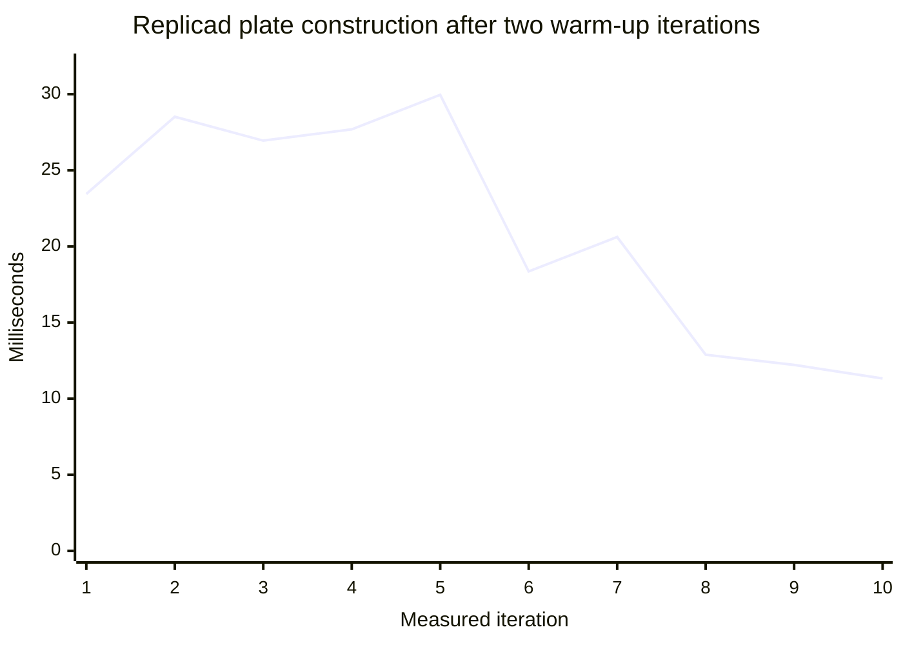

# What VibeWorks ought to be

Vision · 18 November 2026 · Compared against the VibeWorks working tree at `bd4b6e3`, including local changes.

This document describes where VibeWorks should go, not what it does today. Paragraphs marked **Today** name the shipped foundation each idea builds on. Wire syntax, numbers and scenarios below are illustrative unless they cite a measurement or a source. The vision came out of a brainstorm between Farzin, Claude Opus and a GPT-6.2 research agent; [where we disagreed](#where-we-disagreed) is recorded rather than smoothed over. The second half reviews seven open CAD projects and what they do better than us.

[The bet](#the-bet) · [One conversation](#one-conversation-end-to-end) · [Deep interface](#the-deep-interface) · [Collaboration](#humans-and-agents-working-together) · [Motion](#mechanisms-that-move) · [Verification](#verification-how-high-can-we-fly) · [Review and merge](#review-history-and-merge) · [Unmodeled things](#what-nobody-models-yet) · [Openness](#open-by-construction) · [Benchmark](#a-benchmark-for-intent-through-change) · [Disagreements](#where-we-disagreed) · [Today](#what-exists-today) · [Competitors](#learning-from-seven-cad-projects)

## The bet

**VibeWorks should be the last CAD application, at least for the agentic era.** It does not need the interface of SolidWorks, CATIA or AutoCAD, because agents can operate a deep tool surface that no person would want to click through. It rests on four commitments:

1. **Visualization for human users.** People see, point at, scrub, compare and judge the design.
2. **Deep, robust interfaces for agent users.** Agents do the modeling, measuring, checking and bookkeeping through typed commands with honest results.
3. **A real collaboration method between the two.** Feedback, questions, proposals and decisions live on the design, not in screenshots and chat transcripts.
4. **Humans keep taste, agency and the choice of problem.** Agents carry out the execution and the knowledge work.

The reason this is the right bet now: **producing geometry is becoming cheap, and knowing whether it works is not.** CAD-bench (ICML 2026) reports that agent submissions build its right-angle gearbox in 96.9% of attempts and average 4.0% on the gearbox's functional score; agent harnesses "still fail frequently on interfaces, standards-like details, and mechanisms." CADTestBench reaches the same conclusion from the other side by grading Text-to-CAD with executable tests. A model that compiles and renders can still be mechanically meaningless. [CAD-bench failure modes](https://icml.cc/virtual/2026/77860) · [CADTestBench](https://arxiv.org/html/2605.07807v1)

Software solved the equivalent problem with a loop: source, build, test, review, release, on top of version control, continuous integration, diffs and reproducible builds. Mechanical design mostly still runs on exported files, screenshots and an experienced engineer looking hard at a model. VibeWorks should bring that loop to physical design, with agents doing the tedious parts: writing the checks, running the analyses, explaining the diff, chasing the regression.

Two further jobs matter as much as verification. **Finding a better alternative** can be worth more than verifying the edit someone asked for; the designer may never have considered moving the screw. **Discovering what was left unspecified** is engineering work too. An agent that asks which screwdriver the technician carries contributes more than one that proves clearance for a tool it invented.

What VibeWorks is not: a feature-for-feature desktop CAD clone, an embedded AI runtime, or one more geometry authoring language. build123d, CadQuery, KCL and Replicad compete on how pleasant geometry is to write. VibeWorks competes on whether a change can be trusted.

## One conversation, end to end

A technician opens a real enclosure and the cable snags on a rib. In VibeWorks they open the lid to 68°, select the rib and the connector opposite it, and write, "This catches the cable when I open it. Can we keep the outside flush?"

The pin captures their words, the complete snapshot, the component paths, the selected entities, the lid pose, and the camera and section state needed to restore the view. It lands in the agent inbox. The user's own agent, Claude Code, Codex or anything else that speaks MCP, picks it up.

The agent's first reply is a question, posted on the pin: "The bare connector clears by 1.1 mm at every pose from 0° to 110°. The assembly has no cable envelope. Do you mean the connector or the plugged-in cable?" It offers both interpretations as selectable geometry. The technician picks the cable and attaches the supplier drawing. That clarification becomes an assumption in the design, owned and sourced, instead of disappearing into one person's terminal.

The agent then returns two proposals. One moves the rib 4 mm and shows that the boss retaining the board loses wall thickness. The other recesses the connector cutout and keeps the rib. Each opens at the same pose, with before/after switching, the worst pose along the opening path, and the list of affected components: "This changes all six housings." The designer chooses the second. A reviewer accepts it into the design. The release policy notes that the opening clearance is now certified only on part of the opening range and asks for the remaining interval before the next fabrication package.

Six months later another engineer, using a different agent and no access to anyone's chat, clicks the recess and recovers the whole argument: the complaint, the question, the assumption, the rejected alternative and the evidence. After the next build the technician records whether the lid opens cleanly. **If VibeWorks can carry that conversation from one physical observation to the next physical result, people have a reason to adopt it before anyone calls it a standard.**

## The deep interface

John Ousterhout's deep modules have a small interface over a lot of capability. The Unix file system is the canonical example: a handful of nouns and verbs, and every tool from `ls` to a GUI file manager sits on top. VibeWorks should be that for mechanical design. MCP, the CLI, HTTP and the browser are adapters over one model. None of them is the product.

**The primary reader of this interface is an agent.** People increasingly point their agent at a repository, its documentation or its code and let it work out the rest. The contract therefore has to be legible to an agent arriving cold: discoverable through `describe`, backed by runnable examples, honest in its errors, and stable in its meanings. Readability still matters, but the test is whether an unfamiliar agent can use the model correctly on its first attempt.

### Everything has an address

A file system works because every file has a path. Every object in a design should have an **address**: a document, a snapshot, a component path, a declared interface, a face lineage, a pose, a region of empty space, a requirement, a piece of evidence. Pins, checks, joints, requirements, comments and diffs all bind to addresses. Each address states its scope and resolution rule, and resolving it can return *unique*, *ambiguous* or *lost* rather than quietly attaching to a nearby face. An illustrative form:

```text
enclosure@snap:7f3a / lid[2] / interface:hinge_axis
enclosure@snap:7f3a / pose:lid.angle=68deg / region:cable_envelope
```

### Nouns

The glossary already names several of these. New nouns are marked.

| Noun | What it owns |
|---|---|
| **Document** | The editable definition of one part or assembly: features, variables, components, mounts, interfaces and joints. |
| **Snapshot** | A frozen, resolvable closure of a document and every source state it used. Every observation, proposal, finding and release names one. |
| **Address** *(new)* | A reference into a design with an explicit scope and resolution rule, as above. |
| **Thread** *(new)* | A conversation pinned to addresses at a captured state: a request, question, disagreement or note. It can end without any geometry change. |
| **Proposal** *(new)* | A candidate snapshot derived from a base, with its edits, rationale and comparison. Accepting it produces ordinary committed changes. |
| **Requirement** *(new)* | A statement about a design that must stay true, with its owner, source, kind and conditions. Verified by one or more checks. |
| **Evidence** *(new)* | The result of running a check, analysis, inspection or test against a snapshot, with its method, coverage and uncertainty. |

**Change**, **Revision**, **History**, **Activity** and **Checks** keep their glossary meanings.

### Verbs

| Verb | Meaning | Today |
|---|---|---|
| **inspect** | Read anything by address, including capabilities, unresolved threads and stale evidence. | `inspect_model`, `documents`, `workspace_view` |
| **propose** | Create or revise a candidate without touching the committed design. | Exact previews and dry runs of `apply_edits` |
| **analyze** | Run checks or a verifier against a snapshot and conditions; return findings or a durable job. | `analyze_model`, analysis jobs |
| **compare** | Explain the difference between two snapshots in terms of function, interfaces, requirements and geometry. | Not yet |
| **apply** | Make an authorized, revision-checked transition: commit edits, accept a proposal, answer or resolve a thread. | `apply_edits`, `document_action` |
| **subscribe** | Resume an event stream for threads, proposals or evidence from a cursor. | Agent sessions and activity, partly |

The verb names can change. What must not change are four meanings every client depends on: **same design**, **same reference**, **current evidence** and **accepted change**. Agreement on those is worth more than agreement on syntax. Focused conveniences, such as a hole-pattern helper, sit on top of these verbs without widening the core.

## Humans and agents working together

There are three ways to put an AI into a design tool:

1. **Embed a full chat in the application.** The ceiling is high, but you rebuild an agent runtime, model access, tools and memory, and you compete with the hosts people already use.
2. **Hand everything to an external agent over MCP.** This is what VibeWorks does now. It is powerful immediately and meets people where they already work. Collaboration has friction: the person takes screenshots, describes the location in words, and the conversation lives in a terminal nobody else can see.
3. **A hybrid.** The person gives feedback in the visual workspace, pinned to the design. It goes to an agent inbox. The user's own agent picks it up, fixes it, or answers in the same thread with a question or a disagreement, and the person continues the conversation there.

**VibeWorks should do the third, and keep the reasoning in the user's agent.** The architecture already commits to using the user's existing agent host rather than embedding a runtime. The browser needs pins, threads and a proposal viewer; deep reasoning stays in Claude, Codex or whatever comes next.

### Pins that know what you meant

A pin captures the original words and the state in which the problem occurs: snapshot, component paths, selected entities, pose, camera, visibility and section. A person can pin empty space, such as the volume a hand needs. A pin can be precise ("this mounting face") or loose ("everything in this corner feels cramped"); Figma supports both granularities and so should we.

Each pin keeps **two ways home**. One restores exactly what the author saw, years later. The other resolves what the author meant in the current design, through an interface, a face lineage or a component-local point. When a rib splits in two, show the original and both current candidates and let someone choose, widen the pin to the feature, or leave it historical. Never silently reattach it to the nearest face.

**Today:** surface references carry lineage, captured signatures and explicit fragment policies, and missing or ambiguous references already produce an error with repair choices.

### An inbox that survives interruption

Each thread has a stable ID, an author, a human owner, an optional agent delegate and an ordered list of events. The input the agent received is immutable at the moment of delegation; Linear points out that an editable comment is a poor record of what an agent was asked. Delivery can happen twice, so replies are idempotent and in-progress work holds a time-bounded claim. An interrupted session resumes from its cursor, or another agent takes over with the original request and prior findings intact.

**The hard part is waking the agent.** An MCP server can publish a tool, but it cannot make an idle client run it. There are three honest answers, in order of preference:

- A host that supports subscriptions or wake-ups receives the event directly.
- VibeWorks launches the user's own agent CLI for that thread, with the thread address as its task, under the user's credentials and settings. This is dispatch, not an embedded runtime: VibeWorks chooses when to start an agent, and the user's tool does the thinking.
- Otherwise the thread says **Waiting for an agent** and offers a one-line invocation that opens exactly this request in the user's agent.

Leaving a note must stay trivial. Nobody should have to configure a queue or pick a provider to say "this is too close."

### Replies are engineering contributions

An agent earns its place without touching geometry when it answers, asks, or pushes back: "Moving this rib weakens the boss that retains the board. I can move the cutout instead. Here are both sections." A thread can end with an explanation, an accepted proposal, a deliberate deferral or a decision to keep the original. Clarifications that matter become requirements or assumptions on the design.

### Proposals, not surprise edits

Agents working on a thread produce **proposals** against a base snapshot rather than committing straight to the shared design. A proposal opens at the thread's pose with before/after switching, highlighted surfaces, the worst pose and the affected components. When it changes a shared source, the reviewer sees "This changes all six housings" before accepting. If only one placement should change, the choice is explicit: edit the placement, add a variant, or create a new source. Those mean different things on a bill of materials.

Three decisions stay separate, even when one click performs several:

- **Did the agent address the request?** The author resolves or reopens the thread.
- **May this proposal enter the shared design?** An authorized reviewer accepts a specific proposal and its source snapshot.
- **May someone build from this design?** The release policy evaluates requirements, evidence and approvals for the intended use.

A cosmetic note may need only a reply. A modified bearing seat may need manufacturing review after the designer has already approved it.

If a teammate changes the cable while a proposal is open, VibeWorks keeps the original comparison, names the changed input and reevaluates only the evidence that depends on it. A lighting change should not invalidate a clearance decision; a changed cable envelope should. An agent that loses the response to an accept command reconciles the operation receipt before retrying.

**Today:** Follow and Side view already show the human what an agent is working on, and History attributes every change. Threads, proposals and the inbox would build on the same command authority.

### What we take from other tools

| Tool | What to take |
|---|---|
| **Pastel** | An MCP surface for canvas comments: list, read, reply, change status and assign, with comments anchored to an element, a page position or a video timestamp. [MCP server](https://help.usepastel.com/en/articles/16399713-using-the-pastel-mcp-server) |
| **Agentation** | Annotations with intent and status, delivered as events; an agent can acknowledge, resolve with a summary or dismiss with a reason. The annotation schema is public and lives outside the UI that created it. [Agentation 2.0](https://www.agentation.com/blog/introducing-agentation-2) · [API](https://www.agentation.com/api) |
| **Pencil** | A canvas selection becomes context for the agent, and external agents operate the canvas through MCP. I could not confirm a durable pin-to-external-agent inbox in its published docs. [Agent context](https://docs.pencil.dev/core-concepts/ai-agents) · [AI integration](https://docs.pencil.dev/getting-started/ai-integration) |
| **Figma** | Comments pinned to points, frame offsets and regions, and Dev Mode plus MCP recovering implementation context for a selection. [Comments API](https://developers.figma.com/docs/rest-api/comments-endpoints/) · [MCP tools](https://developers.figma.com/docs/figma-mcp-server/tools-and-prompts/) |
| **Onshape** | Comments that tag model entities and become assigned tasks; branch, compare and merge native to CAD. [Comments and tasks](https://cad.onshape.com/help/Content/Collaboration/comments_on_workspaces.htm) · [Compare](https://cad.onshape.com/help/Content/Document/compare.htm) · [Merge](https://cad.onshape.com/help/Content/Document/merging.htm) |
| **tldraw** | Spatial gestures as context: point, draw an arrow, show a motion, with the agent's work appearing on the shared surface. [Agent starter kit](https://tldraw.dev/starter-kits/agent) |
| **Linear** | A human owner and an agent delegate on the same issue, explicit handback, and an immutable record of what the agent received. [Delegation](https://linear.app/docs/assigning-issues) · [Agent guidance](https://linear.app/developers/agent-best-practices) |
| **GitHub** | Answering a review comment, approving a revision and being allowed to merge are separate acts, and an approval goes stale when the change moves. [Resolving reviews](https://docs.github.com/en/pull-requests/concepts/resolving-reviews) |

None of these pins feedback to a feature, an interface, a pose and a revision of a 3D mechanical design. That is open ground.

## Mechanisms that move

VibeWorks has no moving parts today. A lid cannot open, a slide cannot travel and a shaft cannot turn. That gap is large, because many of the questions a mechanical designer cares about are questions about motion.

### Joints in the document

A mount answers "where does this component attach?" A **joint** answers "which relative positions are allowed?" It binds frames on two components, names its type and coordinates with units and sign conventions, and carries limits and a rest position. Fixed, revolute and prismatic joints cover a lid, a shaft and a slide. Real mechanisms also need rigid groups, coupled coordinates such as gear ratios, closed loops and state-dependent constraints such as a latch. Onshape mates, Modelica multibody joints and the STEP AP242 kinematics practice already define much of this vocabulary. [Onshape mates](https://cad.onshape.com/help/Content/Assembly/mates.htm) · [Modelica joints](https://doc.modelica.org/om/Modelica.Mechanics.MultiBody.Joints.html) · [AP242 kinematics practice](https://www.mbx-if.org/home/wp-content/uploads/2024/05/rec_prac_ap242xml_kinematics_v1.2.pdf)

People and agents get the same four operations:

| Operation | Example | Result |
|---|---|---|
| **Pose** | Set `lid.angle` to 68° | Solved placements, remaining freedom, and a useful failure when it cannot solve. |
| **Drive** | Open from 0° to 110° with the latch released | An ordered path. Timing is added only when a claim depends on velocity or force. |
| **Explore** | Drag the lid until it hits something | Interactive feedback, a reproducible pose and the pair that stopped it. Dragging never moves the saved rest position. |
| **Verify** | Require cable clearance through the whole opening | A check whose evidence states the path, contact rules, method, coverage and any unresolved intervals. |

A closed four-bar linkage can assemble two ways for the same input angle. A solver must hold the chosen branch through a drive and report singularities, redundant constraints and ungrounded bodies in terms an agent can repair. Solving each pose independently can produce a beautiful animation of an impossible motion. Drake's inverse-kinematics constraints and research on witness configurations for geometric constraint systems are good starting points. [Drake IK](https://drake.mit.edu/pydrake/pydrake.multibody.inverse_kinematics.html) · [Witness configurations](https://www.sciencedirect.com/science/article/pii/S0010448511001606)

**Motion is also how humans judge.** Dragging a lid open and feeling where it stops is a taste judgment no table of numbers replaces. The visual workspace should make that effortless.

### Four different motion questions

1. **Does it fit here?** One specified pose.
2. **Does it fit along this path?** Every pose of the declared opening, with the latch released and the slide parked.
3. **Does it fit everywhere it is allowed to go?** All permitted combinations of joints, subject to interlocks. One cycle may cover a tiny fraction of this space.
4. **Can a person assemble or remove it?** At least one feasible sequence and path, including tools and hands. A replayable path proves feasibility under the model; a planner that runs out of budget proves nothing.

Intentional contact belongs to specific interfaces in specific states. The lid seal may touch when closed; that must not excuse the hinge flanges colliding halfway open. A gear-ratio constraint relates two shaft angles; tooth form, backlash and contact stress need their own evidence.

### Sweep checks that tell the truth

The simple version evaluates exact B-reps at a sequence of poses and reports it as sampled: "checked 81 poses; smallest observed gap 0.7 mm." A thin obstruction between samples can still be missed, and the evidence must say so. SOLIDWORKS offers interference detection in motion studies; Onshape forum answers suggest it has animated mates and limits but no collision detection during motion, though those posts may be dated. [SOLIDWORKS motion interference](https://help.solidworks.com/2024/English/SolidWorks/motionstudies/t_detecting_interference_motion.htm?format=P&value=) · [Onshape forum](https://forum.onshape.com/discussion/14769/assembly-animation-and-interference-check)

A stronger claim comes from an interval check with a conservative motion bound. Suppose a rigid lid rotates about a hinge, every lid point lies within radius *R* of the axis, and the angle stays within δ radians of an interval's midpoint. No point moves more than *R*δ. If a guaranteed lower bound on the separation at the midpoint, minus *R*δ, still exceeds the required clearance, the whole interval clears. Otherwise subdivide, find a real violating pose, or report the interval as unresolved. The result is honest and useful: "Certified clear from 0° to 73° and 76° to 110°; unresolved between." Calling something the *first* collision requires certifying everything before it.

The catch is the separation bound. An ordinary kernel distance with an undocumented error cannot support a certificate. Getting a defensible bound out of OpenCascade, or from conservative enclosing geometry derived from the solids, is a research problem we would need to solve and document. Display meshes remain useful for fast scrubbing and never certify anything. Research on continuous collision detection shows why the motion and geometry representation matter. [Exact CCD](https://www.cs.ubc.ca/~rbridson/docs/brochu-siggraph2012-ccd.pdf) · [Controlled advancement](https://graphics.ewha.ac.kr/c2a/TVCG13.pdf)

*Moves freely*, *moves under load* and *survives repeated motion* need different evidence: friction, springs and inertia for torque; routing and bend models for cables; duty cycle and material data for fatigue. One lid can show all three without implying they share the confidence of a rigid clearance calculation.

**Speculation:** joints make a design an executable mechanism, which makes export to robotics formats such as URDF and MJCF natural. Getting accurate CAD into robot simulators is a long-standing pain, and it could be one of the communities that adopts VibeWorks first.

## Verification: how high can we fly?

In software, types, linters, unit tests, integration tests, property tests, fuzzing and formal proofs each catch different mistakes. Mechanical engineering already has rich practice of its own. What it lacks is a way to run that practice continuously, through ordinary edits, by agents, with results anyone can inspect.

### What already exists

| Practice | What VibeWorks should learn from it |
|---|---|
| **GD&T and ISO GPS** | ASME Y14.5 and ISO GPS (ISO 8015, ISO 1101) specify acceptable geometric variation. Store the governing system and edition, datum reference frame, tolerance zone and modifiers. A bare `±0.1` loses most of the meaning, and ASME and ISO defaults must never be swapped silently. [ASME Y14.5](https://www.asme.org/codes-standards/find-codes-standards/dimensioning-and-tolerancing) · [ISO 8015](https://www.iso.org/standard/55979.html) · [ISO 1101](https://www.iso.org/standard/66777.html) |
| **Tolerance analysis** | Worst case, RSS and Monte Carlo answer different questions, and the datum scheme, assembly sequence and process distributions can dominate. Commercial tools are mature (TolAnalyst, EZtol, 3DCS); open tools are thin (stackcore, Tol Ninja). [TolAnalyst](https://help.solidworks.com/2024/English/SolidWorks/sldworks/t_using_tolanalyst.htm) · [Jacobian–torsor analysis](https://www.sciencedirect.com/science/article/pii/S0007850607615509) · [stackcore](https://pypi.org/project/stackcore/) · [Tol Ninja](https://github.com/slehmann1/Tol-Ninja) |
| **Semantic PMI** | STEP AP242 carries machine-readable tolerances. NIST publishes test models with expected PMI and a free analyzer. I found no open-source library that reads AP242 semantic tolerances into structured objects, which is a gap an open project could fill. [ISO 10303-242](https://www.iso.org/standard/84300.html) · [NIST PMI test cases](https://www.nist.gov/ctl/smart-connected-systems-division/smart-connected-manufacturing-systems-group/mbe-pmi-0) · [NIST STEP analyzer](https://www.nist.gov/services-resources/software/step-file-analyzer-and-viewer) |
| **Requirements engineering** | SysML v2 (adopted by OMG in 2025) has requirements, satisfy relationships, verification cases and verdicts, plus a standard API. Reuse its concepts and identifiers where a team already has a systems model. [SysML v2](https://www.omg.org/spec/SysML/2.0/Language/PDF) · [Systems Modeling API](https://www.omg.org/spec/SystemsModelingAPI/1.0) |
| **DFM rule checks** | DFMPro, Fusion Design Advice and DFMXpress check draft, wall thickness, undercuts, rib ratios and drill sizes. Whether something is machinable depends on the cutter, the holder and the fixture, so a useful result names the process, tool assumptions and rule edition. [DFMXpress rules](https://help.solidworks.com/2025/English/SolidWorks/dfmxpress/t_rules_configuring.htm?id=28a6340d71234a3b8531511ec693f011) · [Tool accessibility](https://doi.org/10.1115/detc97/dfm-4323) |
| **PCB design rules** | KiCad shows the workflow to copy: scoped rules, severities, click a violation to see the rule, record a local exception with a reason. [KiCad design rules](https://docs.kicad.org/9.0/en/pcbnew/pcbnew.html) |
| **Simulation credibility** | ASME V&V 10 and NASA-STD-7009 separate credible analysis from solver output. A converged solution can answer the wrong problem; record load cases, materials, contacts, mesh convergence and validation. [ASME V&V 10](https://www.asme.org/codes-standards/find-codes-standards/standard-for-verification-and-validation-in-computational-solid-mechanics/2019) · [NASA-STD-7009B](https://standards.nasa.gov/sites/default/files/standards/NASA/B/1/NASA-STD-7009B-Final-3-5-2024.pdf) |
| **Formal geometry** | Exact predicates and certified geometric algorithms settle specific questions for specific representations. Production B-reps with trimmed splines and tolerant topology usually fall outside those domains. [CGAL robustness](https://doc.cgal.org/4.13/Manual/devman_robustness.html) · [Certified modeling](https://www.sciencedirect.com/science/article/pii/S0010448515000494) |
| **Inspection** | QIF exchanges quality data; ISO 14253-1 sets decision rules under measurement uncertainty. A measured diameter belongs with its uncertainty, instrument, datum setup and the serial number it came from. [QIF](https://www.iso.org/standard/77461.html) · [ISO 14253-1](https://www.iso.org/standard/70137.html) |

### Layers of verification

Each layer is reported on its own. Passing a later layer never compensates for missing evidence in an earlier one, and a bench test on one specimen and a proof over every nominal pose each cover something the other cannot.

| Layer | Software analogue | Mechanical question | A useful failure |
|---|---|---|---|
| **References and units** | Types | Are units, frames, component identities and interface roles compatible? Does every address resolve uniquely? | "This axis is in the source frame; the joint needs a component frame. Here are the two placed components." |
| **Build validity** | Compilation | Does the construction rebuild into valid solids of the expected count and kind? Did this cut hit its target? | The first failing feature, preserved inputs, the kernel diagnostic and the last valid result. |
| **Rule decks** | Lint | Does the design break an applicable shop or project rule? Is a critical assumption missing? | The pocket whose corner radius is smaller than the selected cutter, with the cutter and the rule's source. |
| **Interface checks** | Unit tests | Does this interface have the intended bore, pitch, datum orientation and engagement depth? | A dimensioned witness in the interface's own frame. Identity matters: four holes in the wrong place pass a count. |
| **Assembly checks** | Integration tests | Do the actual components mate, clear, seal and engage? Can the specified tool reach the fastener? | The pair, closest points, threshold, actual gap and tool orientation. |
| **Families of designs** | Property tests | Across a range of sizes, do holes stay on pitch and edge distances stay acceptable? | A minimized variable assignment and a replayable pose, with the sample coverage stated. |
| **Check-suite quality** | Mutation testing | Would the checks notice a reversed axis, a suppressed hole or a deleted component? | A plausible wrong design that passed, which exposes a weak requirement. |
| **Domain proofs** | Formal verification | Does an inequality hold at every point of a stated domain, such as every allowed pose? | A counterexample, a checkable bound over the domain, or the remaining undecided region. |
| **Physics and variation** | Load and chaos testing | Under these loads, temperatures and process distributions, what margin or yield remains? | The critical load case, sensitivity to inputs and the model's validity limits. |
| **Physical validation** | Production telemetry | Did real units meet the requirement in the real environment? | A linked test record, build identity, conditions, uncertainty and the gap from prediction. |

A small tolerance example shows why the distinctions matter. A service key is 9.60 ± 0.10 mm wide and its slot is 10.00 ± 0.10 mm. Worst case, the slot exceeds the key by at least 9.90 − 9.70 = 0.20 mm. If the requirement says "at least 0.15 mm total clearance," the margin is 0.05 mm. If the designer meant 0.15 mm *on each side*, the same numbers fail. If the key passes through slots in two separate plates, position and angle can block it even when each width passes. A good agent asks which claim matters; a good check states its idealizations.

### Requirements, checks, evidence, decisions

A requirement is not a check. "A technician can change the filter with the unit installed" may need a clearance check, a driver-access study and a service trial. Replacing that sentence with `clearance >= 2 mm` would throw away the intent. An assumption such as "service uses the short driver" can invalidate all three. A preference such as "hide fasteners from the front" may stay a human judgment forever.

So the verification record keeps four things separately addressable:

| Record | What it holds |
|---|---|
| **Requirement** | Stable ID and edition, the original statement, owner and source, rationale, kind (requirement, assumption or preference), subject addresses, conditions, acceptance threshold and units, and links to governing standards. |
| **Check** | The executable acceptance condition and its procedure: evaluator and version, required inputs, supported geometry, numerical contract and known limits. It may be a built-in query, an external solver, an inspection plan or a human review. |
| **Evidence** | One run of a check against a frozen snapshot and configuration: status, observed value or bound, margin, method, uncertainty, witness geometry and unresolved scope. *Sampled*, *bounded*, *simulated* and *measured* say how it was obtained. |
| **Decision** | Which requirement and proposal were accepted, by whom, for what use, against which evidence. A waiver names the surviving violation, justification, scope, owner and expiry. |

This also gives agents a natural way to work: **test-first design.** The agent turns a request into proposed requirements and checks, a person approves them, and the agent models until the evidence is green. The checks were agreed before the geometry existed, so the agent cannot shape them to fit its result.

**Today:** checks already declare contact, clearance, no-interference, intended overlap (which requires a note), size, within-box and section targets, and are evaluated on rebuild. Analysis is a durable background job, and pending or stale coverage cannot pass health. Those are the seed of the check and evidence records.

### An agent that cannot quietly break the design

The command authority can make some guarantees as strong as software guarantees ever are:

- **The author does not grade itself.** Requirements and their thresholds belong to their owners. An ordinary modeling agent cannot weaken a clearance threshold, remove a checked component, narrow a motion range, loosen a numerical tolerance, change a material, suppress a failing pair or approve its own waiver. Each of those is a visible change to the basis of acceptance, shown prominently in review even when the solid looks identical, and it invalidates the decisions that relied on it.
- **Commit and release are different gates.** Reject corrupt transactions at commit: invalid references, broken revisions, unknown outcomes. Enforce the agreed engineering policy at promotion and release. Exploratory work must be allowed to fail checks; sometimes a designer removes a subsystem before replacing it. A draft export and an artifact with an approved release manifest are different things.
- **Verifiers are untrusted plugins with narrow rights.** An external verifier declares its capabilities, receives an immutable job and returns evidence. It cannot edit the model or the acceptance condition. It can say "unsupported trimmed surface" or "insufficient material data," and the agent can pick a better procedure. High-consequence requirements accept an independently checkable certificate or an independent analysis; two wrappers around the same kernel share the same failure modes.
- **Evidence expires honestly.** Evidence names the complete snapshot it ran against. When an input it depends on changes, it becomes stale. Stale never displays as passing.

**How high can we fly?**

- **Very high:** transaction integrity, traceability, units, dependency freshness, scoped permissions, and specific geometric propositions with certified bounds.
- **High:** well-characterized manufacturing outcomes, where models, process capability and inspection agree.
- **Conditional:** contact, fatigue, flexible parts, environmental exposure and human serviceability.
- **Never guaranteed:** missing requirements and unmodeled failure modes. No system can check a property nobody stated.

The strongest honest promise is this: **VibeWorks makes it very hard to silently lose an established guarantee, and easy to find out exactly which guarantees were ever established.**

## Review, history and merge

**Review leads with function.** A useful comparison first says what an engineer cares about: "Only the lower-left corner changed; all six housings are affected; the cable-clearance requirement went from passing to unresolved." Then it shows the overlay, the moved interfaces, mass and volume changes, and finally raw geometry. Geometry alone misleads in both directions. A new alloy, heat treatment, datum scheme or inspection requirement can be a major change to an identical solid. Two fillet faces becoming three can be irrelevant.

**Identity is a hash; equivalence is a procedure.** A hash of the source closure, evaluator build, settings and external inputs proves what someone received and makes a rebuild reproducible. It cannot prove two kernels made the same useful geometry, because different surface decompositions can describe the same part and equal volumes can describe different ones. Across a kernel upgrade, compare interface frames, dimensions, representative sections, validity, bounded geometric deviation, assembly behavior and export readback, and state the tolerance. [Interoperability via queries](https://tsapps.nist.gov/publication/get_pdf.cfm?pub_id=914283) · [CAx-IF geometric validation properties](https://www.mbx-if.org/home/wp-content/uploads/2024/05/rec_prac_gvp_v46.pdf)

**Merge at the feature graph, then evaluate.** The document is a structured graph of features with stable IDs, not imperative code and not raw B-rep, so a three-way merge is implementable. Take the fasteners from one branch and the ribs from another. A clean textual merge still proves nothing about engineering compatibility: one branch enlarges a connector cutout, another moves a standoff toward it, and together they remove the wall between them. Generate the merged proposal, propagate it through components, rerun checks and show which new interactions have no coverage.

**Bisect when the question is stable.** "Which revision broke the lid clearance?" can be answered automatically by bisecting through History when the check is stable and there is a known good and bad revision. A design can break, recover and break again, so bisect reports what it searched.

**Alternatives keep their reasoning.** Ask for three ways to retain the lid, compare service time, part count and machining setups, take the fasteners from one and the ribs from another. The surviving design keeps the decision: *we chose this because the technician can service it from one side.* That is worth more than thirty-seven unnamed extrusions.

## What nobody models yet

**Empty space as a first-class object.** A technician's hand, a cable's bend envelope, a screwdriver's approach, a coating allowance, a cooling passage and a removal path all occupy space where the product has no solid. Let people select, name and discuss these volumes, with owners, conditions and sources. A negative space can be one of the most important interfaces in a machine, and it gives an agent a precise goal: "Find three arrangements that keep this service volume clear."

**Interfaces with meaning.** Mounting patterns, bores, sealing faces, datums and service volumes should be typed, named objects that features emit, people author and imports acquire through reviewed recognition. Checks, joints and pins bind to them. This avoids most of topological naming, the problem of knowing which face is which after a rebuild, without claiming to solve it in general. An interface also needs a frame, geometry witnesses and a compatibility rule: a bearing seat that keeps its name but reverses its axis must break its consumers visibly. jscad-fiber and tscircuit show the value of components with ports; mechanical design needs the same thing with physical meaning.

**The physical object.** A design revision, its released fabrication package, the unit built with a substituted washer, and that unit repaired six months later are different things. When a printed lid binds, attach the measurements, photos, material, print orientation and measurement method to the revision that was built, and show the nominal clearance beside the measured fit. When a field report arrives, recover which drawing, material lot and cable revision apply, and ask whether a proposed fix helps that population. Over time a team accumulates evidence about its own suppliers and processes that no general model has.

**The next experiment.** When two designs pass every nominal check and the choice depends on an unknown cable stiffness, another render adds nothing. The agent should say, "Both fit the envelope. Which one is better depends on this bend assumption. Here is the one measurement that would settle it, where to take it, and which decision it changes." This gives human judgment a concrete job: deciding which uncertainty is worth paying to resolve.

## Open by construction

VibeWorks is already open source. Openness should mean a fork carries everything: editable geometry, addresses, interfaces, requirements, alternatives, decisions and evidence. A shop that needs only the approved geometry and inspection dimensions takes those, with the revision they came from. A teammate reruns a check where the inputs and method exist, or reads a recorded physical measurement with its scope. Someone using a different agent, or writing their own tools, can still use the design.

**Standardize the smallest contract someone else has a reason to implement.** Not the MCP tool list, but:

- a **snapshot manifest** that names a design and every input it depends on;
- an **address vocabulary** with scopes and resolution outcomes;
- a **requirement and evidence envelope**, so a machine shop can return an inspection result, or an external solver a clearance witness, without implementing the VibeWorks feature evaluator;
- **conformance fixtures** with expected results, and portability levels: can read the solid, preserve PMI, resolve interfaces, evaluate checks, replay features. A round trip reports what it lost.

Publish the editable document format too, versioned and machine-readable, so an agent can learn it from the schema and examples alone. The test of a standard is a second implementation, such as a build123d adapter that evaluates the same document.

**Standards follow usage.** Nobody adopts a protocol because it is well specified; they adopt it because something useful runs on it. VibeWorks earns that by being the tool agents reach for first, because it is the easiest one for an agent to use correctly. In the agentic era, legibility to agents is distribution. Robotics, through joints and simulator export, and hardware teams that already use coding agents are the likeliest early communities.

## A benchmark for intent through change

Existing benchmarks mostly measure generation and simple edits: CAD-bench, CADTestBench, BenchCAD, Parametric CAD Bench, Autodesk's neuralCAD-Edit. neuralCAD-Edit found that automatic metrics correlated weakly with CAD experts' judgments, and VibeWorks' own eval notes admit that an irrelevant model can satisfy numeric gates. [CAD-bench](https://icml.cc/virtual/2026/67851) · [BenchCAD](https://arxiv.org/pdf/2605.10865) · [Parametric CAD Bench](https://cadbench.ai/) · [neuralCAD-Edit](https://autodeskailab.github.io/neuralCAD-Edit/) · [VibeWorks evals](evals.md)

VibeWorks should publish a benchmark for what it claims to be good at: **keeping intent intact through change.** Give the agent a working assembly, a pinned service complaint, an ambiguous supplier substitution and a later change to a dependency. Score whether function was repaired, interfaces preserved, evidence still applies, the right clarifying question was asked, and stale claims were retracted. Use hidden perturbations, a grader the agent cannot edit, and blinded engineering review; accept geometrically different solutions that meet the function.

The same suite serves three purposes: comparing VibeWorks against other tools and competitors on equal tasks, tracking our own regressions across releases, and giving researchers and model labs a reason to run, cite and argue with it. Whoever sets the measure shapes the field.

## Where we disagreed

- **Requirements versus checks.** Claude first proposed checks with provenance as the single building block. Kia argued that a requirement, its acceptance condition, its procedure and its evidence must be separate. Kia was right; the vision uses the four-record model.
- **What review leads with.** Claude proposed geometric diff as the review. Kia argued that function and interfaces come first and geometry second, because material or datum changes can matter more than visible shape. Adopted.
- **Hashes.** Claude proposed hashing B-reps for reproducibility. Kia pointed out that hashes prove identity, not equivalence. Both are now in the vision, doing different jobs.
- **Topological naming.** Claude argued semantic interfaces sidestep the problem. Kia argued they reduce but do not eliminate it, since an interface can keep its name while its geometry changes incompatibly. Interfaces therefore carry compatibility rules.
- **Names.** Kia's proposed nouns included *Change* for a request and *watch* as a verb. The glossary already defines Change as a committed operation and avoids *watch* because of Follow mode. The vision uses Thread, Proposal and subscribe instead, and keeps question threads separate from candidate designs, the way GitHub separates issues from pull requests.
- **Waking the agent.** Kia identified that MCP cannot wake an idle client. Claude proposed that VibeWorks dispatch the user's own agent CLI, which keeps faith with the architecture's rule against embedding an agent runtime. Still open: how much configuration that dispatch needs.
- **Physical-build identity.** Kia treats as-built and as-maintained configurations as core. Claude sees them as the farthest horizon, closer to product lifecycle management than to design. Both agree the measurement record belongs with the revision that was built.

## What exists today

| Vision | Shipped foundation | Missing |
|---|---|---|
| One command authority for every client | MCP, CLI, HTTP and browser share `src/shared/protocol.ts` | Address vocabulary, compare and subscribe as first-class verbs |
| Honest, reproducible state | Atomic, revision-checked edits; operation receipts; snapshots that pin sources; contract fingerprint | Engine-and-input hash for evidence; equivalence procedures across kernel upgrades |
| Collaboration on the design | Attribution in History, Activity, Follow and Side view, exact previews | Pins, threads, inbox, proposals and the three-decision review |
| Requirements and evidence | Declared checks evaluated on rebuild; durable analysis with visible stale and pending coverage | Requirement records, provenance, protected thresholds, release policy, verifier plugins |
| References with meaning | Named mounts; surface references with lineage, signatures and fragment policies | Typed interfaces with compatibility rules; negative-space regions |
| Motion | Static mounts | Joints, pose, drive, explore, sweep checks |
| Manufacturing | STEP, STL, GLB and JSON export; material-based mass | Tolerances and PMI, rule decks, drawings, inspection records |
| Measurement | Agent evals and workspace scorer on three tasks | Public intent-through-change benchmark |

[Architecture](architecture.md) · [Glossary](glossary.md) · [Evals](evals.md) · [README roadmap](../README.md#where-this-is-going)

## Learning from seven CAD projects

The rest of this document is the competitor review that started the vision. It compares Zoo Design Studio, build123d, CadQuery, Replicad, jscad-fiber, brepjs and Tau against VibeWorks at the product, interface, library, packaging, architecture, documentation and performance levels.

### Where to look first

| If we're deciding how to… | Study | What to borrow |
|---|---|---|
| Introduce the workspace to a mechanical designer | Zoo Design Studio | A model with editable source, a visible first action and a way back to the design from its public page |
| Teach a precise modeling operation | build123d and CadQuery | A dimensioned object, intermediate geometry, runnable code and a parameter the reader can change |
| Help a developer embed or reuse modeling work | Replicad and Tau | Explicit runtime dependencies, executable examples and instructions for taking the project outside the editor |
| Build a reusable catalogue of related parts | jscad-fiber | One component with named dimensions and visible variants, with its source beside the render |
| Help agents recover from kernel failures | brepjs | Operation-specific failure information and a small model that reproduces the failure through export |
| Decide whether geometry needs optimizing | build123d | Measure actual parts across revisions. Keep a failing input, identify the expensive operation, and rerun after the fix |

**Our comparison point.** MCP, CLI and browser edits share a command catalogue, revision checks and a bounded Node worker pool. Replicad and its OCCT WASM build are already pinned together. VibeWorks also has manual modeling, named mounts, semantic references with repair rules, editable JSON, a headless evaluator and a workspace scorer that follows transitive part sources. Recommendations below assume those facilities. General sketch constraints and assembly motion are documented scope gaps. [Architecture](architecture.md) · [Manual tools](manual-modeling.md) · [Working examples](modeling-examples.md) · [Agent evals](evals.md) · [Kernel loader](../src/cad/node-worker-entry.ts)

**How to read the evidence.** Zoo and Tau compete for the workspace. build123d, CadQuery, Replicad and brepjs compete for developers who want to author exact geometry in a familiar language. jscad-fiber is a component model over JSCAD. Evidence of an attractive design, an editable recipe, a valid solid and a successful STEP round trip answers four different questions. Each section identifies what the sources demonstrate. The hands-on measurements at the end cover one small part.

### What the three supplied screenshots communicate

The build123d README uses three models to teach three different things before the reader reaches the feature list. The enclosure shows a recognizable end product, the transparent underside reveals internal ribs, and the folded bracket beside a flat outline invites the reader to investigate how the shape was made. The cheat sheet, examples and discussion links are nearby. For our bracket, a finished render, an underside view with the hole pattern visible, and one dimensioned before/after edit would each answer a distinct engineering question. [build123d README](https://github.com/gumyr/build123d#readme)

Zoo's landing screen offers desktop download and a browser trial beside a populated workspace. Its empty editor still has three named planes, a prominent **Start Sketch** action, command search and an agent panel that explains selection context and offers a concrete gear prompt. The populated screen shows a part tree and project files beside the same canvas. Together they answer “where do I start?” and “what does a real project grow into?” VibeWorks already has context-sensitive tools, command search and a shared selection. An equivalent first action for our product would be **open the bracket and ask your connected agent to change the hole spacing**. That also teaches how manual selection and an external agent work together. The screenshots establish layout and copy. They cannot tell us how well Zoo understands a selection or how fast the model rebuilds. [Zoo Design Studio](https://zoo.dev/design-studio) · [VibeWorks manual interaction](manual-modeling.md)

### Zoo Design Studio

Zoo ships a hybrid CAD workflow. Sketch and feature-tree actions edit KCL, the same human-readable parametric source that users and the built-in Zookeeper agent can change. The MIT-licensed app implements source changes through AST transformations and includes the Rust KCL implementation. The production Stream path sends commands over WebSockets to Zoo’s proprietary B-rep engine and receives viewport video over WebRTC. Desktop Directory libraries keep project files on disk, while the browser uses Personal Cloud. The verified v1.5.5 release offers a universal macOS DMG, Windows installer and ARM64/x86-64 Linux AppImages. CAD modeling is free in Design Studio, with a shared allowance for Zookeeper reasoning and billable API use. [Product and billing FAQ](https://zoo.dev/docs/faq), [app README](https://github.com/KittyCAD/modeling-app/blob/e550eaaba0631acf3b449e41ef63fa6fd55983d6/README.md), [AST implementation](https://github.com/KittyCAD/modeling-app/tree/e550eaaba0631acf3b449e41ef63fa6fd55983d6/src/lang/modifyAst), [Stream docs](https://zoo.dev/docs/zoo-design-studio/features/system-requirements/zoo-stream), [release assets](https://github.com/KittyCAD/modeling-app/releases/tag/v1.5.5).

Zoo also exposes billable Engine and Agent WebSockets at `/ws/modeling/commands` and `/ws/ml/copilot`, plus file conversion and measurement APIs. External agents can use the separately packaged `uvx zoo-mcp` server. It exposes KCL execution, measurements and snapshots with an explicit engine session, and reports mock preflight and real execution separately. Public Aquarium search and source retrieval work without login. [API billing and endpoints](https://zoo.dev/docs/developer-tools/api/billing), [MCP README](https://github.com/KittyCAD/mcp#readme).

Aquarium’s All view presents moderated project snapshots. I checked its public listing and retrieved source archives for Zoo’s Mounting Plate, Helical Planetary Gearset and a community vise. To reproduce the vise edit, download and unpack the Swivel-Base Bench Vise source, open its folder in Design Studio and change `jawOpening` from `60mm` to `100mm` in `main.kcl`. The 22-file KCL project imports individual parts and computes the moving jaw’s placement from that parameter. Expect 40 mm of jaw travel with the base fixed. Export both states using `zoo kcl export --output-format=step <project-dir> <output-dir>` and measure the jaw gap. I inspected the archive and placement expressions. Execution and STEP readback remain unverified. [Aquarium All](https://zoo.dev/aquarium?category=All), [Mounting Plate](https://zoo.dev/aquarium/089a9535-f766-438e-971a-73b5ee08708b), [Helical Planetary Gearset](https://zoo.dev/aquarium/3e9eee84-c9e9-4e96-a97b-0867d14179d9), [vise project](https://zoo.dev/aquarium/f60b665a-bc13-4fd7-9217-1903cdf1f77c), [vise source archive](https://zoo.dev/api/projects/public/f60b665a-bc13-4fd7-9217-1903cdf1f77c/download?format=zip), [publishing docs](https://zoo.dev/docs/zoo-design-studio/features/data-management/aquarium), [CLI export reference](https://zoo.dev/docs/developer-tools/cli/manual/zoo_kcl_export).

Zoo’s public macOS Electron regression job passed a recent paired run. The gate checks for regressions in control readiness on a small fixture and records 150 ms target breaches separately. Large projects, camera motion and completed geometry operations are outside its coverage. Stream responsiveness also depends on network latency and packet loss. I found no comparable end-to-end Zoo/VibeWorks timings. A user supplied a minimal KCL union that fails in Zoo CLI and reported successful fusion in OpenCascade. Zoo routed the open issue to its engine team. A separate Windows user reported repeated STEP export disconnects on v1.5.2, with the cause unconfirmed. [Performance method](https://github.com/KittyCAD/modeling-app/blob/e550eaaba0631acf3b449e41ef63fa6fd55983d6/docs/interaction-performance.md), [CI result](https://github.com/KittyCAD/modeling-app/actions/runs/44265479601/job/134673513629), [network caveats](https://zoo.dev/docs/zoo-design-studio/features/system-requirements/zoo-stream#network-requirements), [union report](https://github.com/KittyCAD/modeling-app/issues/14690), [export report](https://github.com/KittyCAD/modeling-app/issues/14759).

VibeWorks gives external agents and the browser one typed command authority, with SQLite revision history, atomic edit batches and local OpenCascade workers. Its README gallery shows real captures but ships without those editable projects. Publish one complete VibeWorks fixture using the existing MCP mounting-plate demo. Include editable JSON, the exact bounds and validity checks, and STEP for a documented parameter change. Report edit-to-commit and export timings separately from the existing exact-replay benchmark. A prospective user can then inspect the source, repeat the edit and verify the delivered geometry. [Architecture](architecture.md), [MCP implementation](../src/bridge/mcp.ts), [gallery](../README.md), [MCP demo](../scripts/mcp-demo.ts), [replay benchmark](../scripts/benchmark-replay.ts).

### build123d

build123d is an Apache-2.0 Python library for exact OpenCascade B-rep modeling. The Python script is the editable design. Builder mode accumulates geometry in nested `BuildPart`, `BuildSketch`, and `BuildLine` contexts, with a `ContextVar` holding the active scope. Algebra mode combines shape objects with operators such as `-` for subtraction and `*` for placement. A script can use ordinary Python functions, loops, and geometric selectors to generate a family of parts. The official docs show a teacup with a revolved and hollowed bowl, a swept handle, and a volume assertion, plus a bicycle tire that wraps planar tread onto a curved face. [README](https://github.com/gumyr/build123d/blob/v0.13.0/README.md) · [Builder implementation](https://github.com/gumyr/build123d/blob/v0.13.0/src/build123d/build_common.py#L1436-L1443) · [Algebra API](https://build123d.readthedocs.io/en/stable/key_concepts_algebra.html) · [Teacup](https://build123d.readthedocs.io/en/stable/) · [Bicycle tire](https://build123d.readthedocs.io/en/stable/examples_1.html#bicycle-tire)

For the inspected 0.13.0 release, PyPI ships a platform-neutral Python wheel and a source distribution. The package requires Python 3.11–3.14 and native `cadquery-ocp-novtk` 8.0.x, so the wheel tag alone does not establish platform support. `ocp-vscode` is a separate viewer. Scripts can export STEP, STL, 3MF, DXF, and SVG. The third-party `build123d-mcp` already exposes persistent Python execution, measurement, rendering, validation, and export to agents. [PyPI](https://pypi.org/project/build123d/0.13.0/#files) · [Packaging](https://github.com/gumyr/build123d/blob/v0.13.0/pyproject.toml#L16-L57) · [Installation](https://build123d.readthedocs.io/en/stable/installation.html) · [Formats](https://build123d.readthedocs.io/en/stable/import_export.html) · [MCP adapter](https://github.com/pzfreo/build123d-mcp#what-it-can-do)

**Reproducible use case.** Install with `python -m pip install build123d==0.13.0` in a Python 3.12 virtual environment. This headless adaptation of the upstream perforated panel creates a 500 × 600 × 1 mm plate with 625 hexagonal through-holes. The volume check subtracts the analytic hexagon areas from the blank. [Upstream example](https://github.com/gumyr/build123d/blob/v0.13.0/examples/fast_grid_holes.py) · [OCCT face construction](https://github.com/gumyr/build123d/blob/v0.13.0/src/build123d/topology/utils.py#L200-L255)

```python
from math import sqrt
from build123d import Face, HexLocations, Rectangle, RegularPolygon, export_step, extrude

outline = Rectangle(500, 600).wire()
hexagon = RegularPolygon(9, 6, major_radius=True).wire()
openings = HexLocations(10, 25, 25) * hexagon
panel = extrude(Face(outline, openings), amount=1)
expected_volume = 500 * 600 - 625 * (3 * sqrt(3) / 2) * 9**2
assert len(panel.solids()) == 1 and panel.is_valid
assert abs(panel.volume - expected_volume) < 0.001
assert export_step(panel, "perforated-panel.step")
```

The docs report about **1.02 s** for face construction and extrusion on an unspecified Linux laptop, with no quantified sequential-cut baseline. The benchmark workflow publishes per-platform pytest CSVs for modeling and meshing cases. In issue #1030, a user generating tessellations measured **97.6 s** to assemble a compound of 19,683 disjoint cubes after **8.1 s** to create the cubes. In issue #1568, the maintainer reproduced a cut failure aligned with a vertical fillet and attributed it to OCCT. Those timings and failures are upstream reports. I ran the panel recipe with build123d 0.13.0. STEP readback with CadQuery found one valid solid, 625 inner wires on the perforated face and a volume of 168,472.391801 mm³. I did not time this panel. [Panel timing](https://build123d.readthedocs.io/en/stable/examples_1.html#fast-grid-holes) · [CI benchmarks](https://github.com/gumyr/build123d/blob/v0.13.0/.github/workflows/benchmark.yml) · [Compound report](https://github.com/gumyr/build123d/issues/1030) · [Fillet report](https://github.com/gumyr/build123d/issues/1568)

**VibeWorks implication.** The current checkout gives the browser and agents one revision-checked command path with durable history and exact geometry in Node OpenCascade WASM workers. Its `extrude` constructs a face from one wire, and `drill_holes` performs sequential circular cuts with a 32-center limit per feature. Use the plate as a fixture for evaluating bounded inner profiles on the existing `extrude` command. Preserve authored edge lineage. Check solid count, opening count, analytic volume, and STEP readback. Time the same geometry on one machine and record kernel, commit, and display time independently. [Architecture](architecture.md) · [Profile schema](../src/shared/protocol.ts) · [Extrusion](../src/cad/geometry.ts) · [Drill limit](../src/shared/protocol.ts) · [Drilling loop](../src/cad/geometry.ts) · [Replay benchmark](../scripts/benchmark-replay.ts)

### CadQuery

CadQuery is an Apache-2.0 Python library for parametric mechanical CAD. The versioned design is the Python script, so dimensions, loops and helper functions are ordinary code. STEP carries geometry for interchange, while the script carries the editable recipe. The official examples progress from a drilled plate to a shelled enclosure, connector panel and cycloidal gear, with API links beside each example. The separate PyQt CQ-editor adds a script debugger, automatic reload and visual inspection of the object stack. [Official site](https://cadquery.github.io/) · [README](https://github.com/CadQuery/cadquery/tree/v2.8.0#readme) · [Examples](https://cadquery.readthedocs.io/en/stable/examples.html) · [File formats](https://cadquery.readthedocs.io/en/stable/importexport.html) · [CQ-editor](https://github.com/CadQuery/CQ-editor#notable-features)

**API and packaging.** The fluent `Workplane` chain combines a local coordinate frame, an object stack and geometric selectors such as `faces(">Z")`. Sketches and assembly constraints have their own APIs. Release 2.8.0 also stabilizes `cadquery.func` and adds history support to that API. The implementation opens onto OCCT through OCP. For example, `cboreHole` fuses the bore and recess cylinders, copies the cutter to each selected location and hands all cutters to one OCCT subtraction. PyPI 2.8.0 requires Python ≥3.11 and declares `cadquery-ocp>=7.9.3.1,<8.0`. The CadQuery wheel itself is platform-independent, while OCP requires platform binaries. The README favors conda or the bundled editor installer for support. [API reference](https://cadquery.readthedocs.io/en/stable/apireference.html) · [Release changes](https://github.com/CadQuery/cadquery/blob/v2.8.0/changes.md#280) · [Counterbore implementation](https://github.com/CadQuery/cadquery/blob/v2.8.0/cadquery/cq.py#L2784-L2869) · [PyPI](https://pypi.org/project/cadquery/2.8.0/) · [OCP wheels](https://pypi.org/project/cadquery-ocp/7.9.3.1/#files) · [Dependency spec](https://github.com/CadQuery/cadquery/blob/v2.8.0/setup.py#L26-L58)

**Reproducible use case.** Adapt the official 608 bearing pillow block for headless execution. In a Python 3.12 virtual environment, install `cadquery==2.8.0` and `cadquery-ocp==7.9.3.1.1`, then run this script. The expected result is one valid 80 × 60 × 10 mm solid with a Ø22 through bore, four Ø2.4 through holes and Ø4.4 × 2.1 mm recesses. The volume target is derived analytically. I ran this script and reopened its STEP. The reader found one valid solid, bounds of 80 × 60 × 10 mm and a volume of 43,069.585920 mm³. [QuickStart](https://cadquery.readthedocs.io/en/stable/quickstart.html#filleting)

```python
import cadquery as cq

width, length, thickness = 80, 60, 10
centers = [(x * (width / 2 - 6), y * (length / 2 - 6))
           for x in (-1, 1) for y in (-1, 1)]
block = cq.Workplane("XY").box(width, length, thickness).edges("|Z").fillet(10)
block = block.faces(">Z").workplane().hole(22)
block = block.faces(">Z").workplane().pushPoints(centers).cboreHole(2.4, 4.4, 2.1)
assert block.solids().size() == 1 and block.val().isValid()
assert abs(block.val().Volume() - 43069.58592) < 0.01
block.export("pillow-block.step")
```

**User evidence and performance.** In issue #2129, a user’s chamfer propagated around the bottom after a fillet despite selecting the long edges. A maintainer suspected OCCT and suggested reordering the operations, which the user said changed the appearance. Issue #2119 reports 3.018 s to import CadQuery versus 10.4 ms to build and measure a box on one Windows system. ModelRift measured 1.56–1.95 s CadQuery recomputes across three agent-authored parts, with one run per tool and task and independently authored geometry. A VibeWorks speed comparison would require matched geometry and separate timing of startup, rebuild and export. [Chamfer report](https://github.com/CadQuery/cadquery/issues/2129) · [Import timings and script](https://github.com/CadQuery/cadquery/issues/2119) · [ModelRift results and caveats](https://modelrift.com/blog/cadquery-vs-openscad/#results)

**VibeWorks lesson.** Both use exact OCCT solids. VibeWorks puts typed, revision-checked edits and undo behind one bridge for agent and browser, with explicit failures for changed or ambiguous supported surface references. Its current `drill_holes` takes one diameter and cuts through, so this block would use separate drilling operations and shallow cylinder subtractions. Publish the same editable block through the existing `apply_edits` workflow. Show a width change that moves all four mounting centers, verify bore and recess dimensions and read back STEP. Measure cold startup, warm rebuild and export separately. The fixture would test the shared workflow while showing where CadQuery’s workplane and counterbore API save authoring effort. [Architecture](architecture.md) · [Edit schema](../src/shared/protocol.ts) · [Drilling implementation](../src/cad/geometry.ts) · [Surface references](../src/cad/surface-reference.ts) · [Replay benchmark](../scripts/benchmark-replay.ts)

### Replicad

Replicad is both VibeWorks’ geometry dependency and a competing way to author CAD. It lets developers write parametric JavaScript against OpenCascade and build their own editors or configurators. The public Studio workbench puts code beside the model, and the docs open examples directly in that editor. The same script can drive a shareable configurator through `defaultParams`. The cycloidal gear demonstrates a parametric profile, a 90° twist extrusion and a bored shaft hole. The watering can combines a revolve, a loft through tilted sections and a shell that removes two selected faces. [Project and README](https://github.com/sgenoud/replicad), [Workbench guide](https://replicad.xyz/docs/tutorial-overview/using-the-workbench/), [Share URL implementation](https://github.com/sgenoud/replicad/blob/5e4ad9bb5a35bb9ae0571e91c25fa1897ba0570c/packages/replicad-docs/examples/helpers.js), [Gear](https://replicad.xyz/docs/examples/cadquery-gear/), [Watering can](https://replicad.xyz/docs/examples/design-watering-can/).

**API and packaging.** The TypeScript library injects its kernel with `setOC` and exposes chainable sketches and solids, geometry-based edge and face finders, and distinct calls for display meshes and STEP/STL export. Studio’s Comlink worker evaluates scripts and loads both OpenCascade and Manifold WASM. npm publishes the MIT-licensed library with ESM, CommonJS and declarations, alongside the LGPL-2.1-only custom OpenCascade binding with separate default and `/multi` WASM entry points. Both are at 1.2.1 in the registry. The Three.js helper consumes display geometry, and the Node CLI exports STEP, STEP assemblies, STL and JSON, with SVG projection support. [API](https://replicad.xyz/docs/api/), [Integration guide](https://replicad.xyz/docs/use-as-a-library/), [Studio worker](https://github.com/sgenoud/replicad/blob/5e4ad9bb5a35bb9ae0571e91c25fa1897ba0570c/packages/studio/src/builder.worker.js), [Library manifest](https://registry.npmjs.org/replicad/1.2.1), [WASM manifest](https://registry.npmjs.org/replicad-opencascadejs/1.2.1), [CLI README](https://github.com/sgenoud/replicad/blob/5e4ad9bb5a35bb9ae0571e91c25fa1897ba0570c/packages/replicad-cli/README.md).

**Reproduce a Gridfinity stacking-lip defect.** Open the official generator or paste its pinned script into Workbench. Leave the other defaults in place and compare `xSize=6, ySize=2` with `xSize=2, ySize=6`. Issue #251 reports that the first orientation puts the lip outside the bin. I ran the pinned script directly with VibeWorks’ installed 1.1.0 package pair. Both results contained one valid B-rep solid, but their XY spans were 257.046 × 89.046 mm and 83.500 × 251.500 mm. Changing only the top-lip sweep to `withContact: false` restored transposed spans in this run. That checks the footprint, while fit still needs verification. [Generator](https://replicad.xyz/docs/examples/gridfinity/), [Pinned script](https://github.com/sgenoud/replicad/blob/5e4ad9bb5a35bb9ae0571e91c25fa1897ba0570c/packages/replicad-docs/examples/gridfinity.js), [User report](https://github.com/sgenoud/replicad/issues/251), [VibeWorks dependency pins](../package.json).

**Performance and review.** In one local Apple M4 / Node 26 run, the two 12-cell cases took 367–400 ms to construct after kernel initialization and another 471–593 ms for bounds, volume and default face tessellation. These figures cover the pinned 1.1.0 pair in Node. Browser startup, 1.2.1 runtime and export were unmeasured. A 2024 text-intersection report saw roughly 1–5 minutes on M1 Pro versus about 10 seconds for the maintainer on Intel. Other users reported obsolete work blocking recomputation and errors interrupting visual comparison. [Text-intersection timings](https://github.com/sgenoud/replicad/issues/159), [Worker cancellation discussion](https://github.com/sgenoud/replicad/issues/236), [Workbench error feedback](https://github.com/sgenoud/replicad/issues/176).

**Lesson for VibeWorks.** Use Replicad’s example-to-editor flow as a model for opening the existing mounting-bracket eval as an editable example. Expose its named dimensions, use the shared revision-checked dry run to preview changes, and show exact bounds and a hole cross-section beside the last committed design. Score a dimension change as well as the initial solid. Studio evaluates the script in a browser worker. VibeWorks runs the matched kernel in Node workers behind one authority for browser, MCP and CLI, with durable revisions in SQLite. Its workers can be terminated on deadline, and a failed edit preserves the committed design. The Gridfinity result shows why a valid solid can still fail a fit requirement. [Bracket eval](evals.md), [Edit architecture](architecture.md), [Worker deadlines](../src/cad/node-worker.ts), [Section measurement command](../src/shared/protocol.ts).

### jscad-fiber

**Product and adoption.** jscad-fiber is tscircuit’s MIT-licensed library for authoring parametric JSCAD models as React components. Its official site is a React Cosmos gallery with 34 deployed fixtures, including a sphere cut from a cube, helical extrusion, and a mesh embedded in a Three.js scene. Fixtures pair the result with a “Show Code” control. The README covers primitives, transforms, booleans and extrusions. The sibling `jscad-electronics` package depends on it and shows how to render an SOT-23 package and its PCB pads together. [Official gallery](https://tscircuit.github.io/jscad-fiber/) · [README and license](https://github.com/tscircuit/jscad-fiber#readme) · [Electronics usage](https://github.com/tscircuit/jscad-electronics#usage) · [Downstream manifest](https://github.com/tscircuit/jscad-electronics/blob/main/package.json)

**API and packaging.** npm’s latest tag was `0.0.94`, published November 9, 2026, matching the GitHub HEAD inspected. The ESM package ships TypeScript declarations and pins React and React DOM peers to 19.1.0. The root exposes `JsCadView`, `/three` exposes `JSCadThreeMesh`, and both sit over a host that maps JSX to JSCAD operations. The README’s `ExampleWrapper` import is absent from the root exports. `/headless` compiles synchronous, hook-free JSX to serializable operation JSON without loading Three.js or the kernel. `/model` evaluates pure JSX against a supplied JSCAD kernel and returns geometry plus named references, including extrusion outlines with holes and model-space transforms. Those outlines preserve authored profiles through later cuts, so they can differ from the surviving boundary. [npm manifest](https://registry.npmjs.org/jscad-fiber/latest) · [Root exports](https://github.com/tscircuit/jscad-fiber/blob/6a54f40e6a49e184f1c516d5aea671278a94ed66/lib/index.tsx) · [Three entry](https://github.com/tscircuit/jscad-fiber/blob/main/lib/three.tsx) · [Headless and native model docs](https://github.com/tscircuit/jscad-fiber#headless-plans-and-named-reference-rectangles)

**Reproducible design.** At the [release commit](https://github.com/tscircuit/jscad-fiber/tree/6a54f40e6a49e184f1c516d5aea671278a94ed66), run `bun install --frozen-lockfile` and `bun test tests/headless-plan.test.tsx`. The motor spacer is a 42 × 42 × 4 mm plate with four hollow posts on 31 mm centers, 3.2 mm clearance holes and a 30 mm central opening. The test compiles heights of 10 and 18 mm, checks bounds from `[-21,-21,0]` to `[21,21,height]` and clearance with intersection probes, and verifies that the named `board` reference moves with height while `motor` stays at Z=0. Use `resolveReferencePlanes` before handing the JSON to an older interpreter. [Spacer source](https://github.com/tscircuit/jscad-fiber/blob/main/examples/motor-spacer.tsx) · [Test](https://github.com/tscircuit/jscad-fiber/blob/main/tests/headless-plan.test.tsx) · [Planner contract](https://github.com/tscircuit/jscad-planner/blob/d6d30903b1c747faa1a48e9aa4e70ac7bb9b3b37/README.md#named-reference-planes)

**Feedback and performance.** A user asked to render LLM-generated JSCAD strings and reported using WebContainers and the JSCAD CLI to obtain STL. A separate request to control camera, size and background led to the discussion behind the embeddable mesh API. Source inspection shows that `JsCadView` rebuilds the scene on child changes, draws continuously and disposes resources on teardown. The low/high geodesic fixtures use frequencies 6 and 12, producing 20 and 80 source triangles by JSCAD’s subdivision formula. That gives a mesh-size comparison for one primitive. VibeWorks documents worker overlap and RSS observations on exact workloads, which cannot be compared directly to the gallery. I found no published jscad-fiber latency, memory or throughput benchmark. I ran the pinned headless-plan test file on Bun 1.3.14. All eight tests passed, including the two-height spacer and its clearance probes. [String request #107](https://github.com/tscircuit/jscad-fiber/issues/107) · [Viewer request #25](https://github.com/tscircuit/jscad-fiber/issues/25) · [Viewer code](https://github.com/tscircuit/jscad-fiber/blob/main/lib/components/jscad-view.tsx) · [Low-frequency fixture](https://tscircuit.github.io/jscad-fiber/code-examples/low-geodesic-sphere.fixture.tsx) · [High-frequency fixture](https://tscircuit.github.io/jscad-fiber/code-examples/high-geodesic-sphere.fixture.tsx) · [VibeWorks measurements](headless.md) · [Subdivision source](https://github.com/jscad/OpenJSCAD.org/blob/master/packages/modeling/src/primitives/geodesicSphere.js#L34-L66)

**VibeWorks lesson.** VibeWorks already has named mounts and align/mate placement, plus revision-checked edits through one OpenCascade B-rep authority for browser, CLI and MCP. jscad-fiber’s solid model is polygonal CSG. Publish one copyable VibeWorks spacer recipe as existing `apply_edits` JSON beside its rendered result. Show the two heights, expected bounds and named mount frames, then mate a board to the upper mount. VibeWorks mount fields are currently static. Changing the spacer height also requires updating the upper mount frame. This example would make that limitation visible and give us a concrete case for a parameter-bound mount. [Architecture](architecture.md) · [Mount example](modeling-examples.md) · [Protocol](../src/shared/protocol.ts) · [JSCAD mesh conversion](https://github.com/tscircuit/jscad-fiber/blob/main/lib/convert-csg-to-three-geom.ts)

### brepjs

**Product and packaging.** brepjs is an Apache-2.0, code-first CAD library that grew out of Gridfinity Layout Tool. Its browser playground runs editable TypeScript examples, and the install guide, cookbook and TypeDoc take users from a sketch or primitive to STEP. The API exposes functional operations such as `cut` and `fillet` with typed `Result` errors, plus a fluent `shape()` wrapper. The `ValidSolid` brand records a runtime kernel check in the type system. npm lists `brepjs` 20.28.3 and `brepjs-cad` 0.194.1, both requiring Node ≥24. The ESM-only `brepjs/quick` initializes OpenCascade via `occt-wasm`, with a fallback to `brepjs-opencascade`. The separate CAD package ships the `brep` CLI and stdio `brep-mcp`, whose `run_program` tool executes supplied TypeScript and returns the verification report. A Claude Code skill teaches the authoring loop. [Website](https://brepjs.dev/) · [README](https://github.com/andymai/brepjs/blob/8efc24bc512821afb46f0bc26239f082fb931c04/README.md) · [Cookbook](https://github.com/andymai/brepjs/blob/main/docs/cookbook.md) · [TypeDoc](https://andymai.github.io/brepjs/) · [Kernel loader](https://github.com/andymai/brepjs/blob/8efc24bc512821afb46f0bc26239f082fb931c04/src/quick.ts) · [MCP implementation](https://github.com/andymai/brepjs/blob/546201a8e756c4dd029ce25022558e9fef68289b/packages/brepjs-cad/src/mcp/tools.ts#L38-L58) · [Core npm metadata](https://registry.npmjs.org/brepjs/20.28.3) · [CAD npm metadata](https://registry.npmjs.org/brepjs-cad/0.194.1)

**Runnable design.** Copy the published `mounting-bracket.brep.ts` fixture into a Node 24+ npm project and install `npm i -D brepjs@20.28.3 brepjs-cad@0.194.1 occt-wasm@5.17.2`. It fuses a 60 × 40 × 6 mm base to a 6 mm web that rises 34 mm above it, then cuts four Ø6 mm through-holes. Add `export const expected = { volume: 26640 - 216 * Math.PI, tolerancePct: 0.5 }` and run `npx brep verify mounting-bracket.brep.ts --check --json report.json && npx brep export mounting-bracket.brep.ts --step`. The published baseline is a valid Compound at 25,961.416 mm³. The implementation type-checks on request, then measures and compares the executed shape. `verify --step` can write STEP before reporting failure, so the example uses the gated export command. At showcase scale, the 1U chassis unfolds seven sheet-metal parts and nests four sets into one DXF. Its layout is a display design. [Fixture](https://github.com/andymai/brepjs/blob/546201a8e756c4dd029ce25022558e9fef68289b/packages/brepjs-cad/skills/brepjs-implement/examples/mounting-bracket.brep.ts) · [Baseline](https://github.com/andymai/brepjs/blob/546201a8e756c4dd029ce25022558e9fef68289b/packages/brepjs-cad/skills/brepjs-implement/examples/mounting-bracket.expected.json) · [Verifier](https://github.com/andymai/brepjs/blob/546201a8e756c4dd029ce25022558e9fef68289b/packages/brepjs-cad/src/verify/runPart.ts#L246-L345) · [CLI reference](https://brepjs.dev/agent/cli) · [Chassis source](https://brepjs.dev/examples/server-chassis)

**Evidence and caveats.** In the maintainer’s 46-part Claude Code eval, 31 passed first verify, 46 passed after repair, and 35 matched or exceeded the reference in a blind model-judged render comparison. The results apply to that gallery and model setup. The November 14 five-iteration Linux/Node microbenchmark put the beta brepkit backend’s median box-cylinder cut at 20.8 ms versus 26.7 ms for occt-wasm. This measures a single operation in brepjs. The same project’s downstream Gridfinity report found a cold-cache v15 regression from ~800 to ~1,065 ms despite unchanged tracked WASM timings. A separate integrator reported a fillet on a boolean result leaking 31 live WASM handles per recompute under occt-wasm. The merged fix adds leak regression tests. These are historical, workload-specific observations. [Eval](https://brepjs.dev/agent/eval#results-2026-10-28) · [Kernel timings](https://github.com/andymai/brepjs/blob/8efc24bc512821afb46f0bc26239f082fb931c04/benchmarks/results/latest.md) · [Gridfinity issue](https://github.com/andymai/brepjs/issues/740) · [Integrator report](https://github.com/andymai/brepjs/issues/1749) · [Fix](https://github.com/andymai/brepjs/pull/1750)

**Implication for VibeWorks.** brepjs hands off a TypeScript program. VibeWorks hands off a shared, editable feature graph, with browser and agent edits going through one revision-checked authority backed by SQLite and isolated Replicad/OpenCascade workers. Its existing inspection, analysis, contact sheets, STEP export and bracket eval already cover most of the verification loop. Make that loop a copyable quickstart using the existing mounting-bracket task. Pin the reviewed document revision, show exact bounds and one solid, have the agent change the hole diameter and confirm the four bores, then link the matched views and STEP receipt. For a head-to-head, give both tools that same brief and record cold and repeated end-to-end times after checking equivalent geometry. The local replay script already records wall time, kernel time and cache state. [Architecture](architecture.md) · [Command contract](../src/shared/protocol.ts) · [Bracket task](../scripts/evals/tasks/mounting-bracket.json) · [Replay timing](../scripts/benchmark-replay.ts)

### Tau

Tau puts chat, parametric source, a 3D viewport, parameter controls and revision history in one workspace. It ships a browser app, Electron desktop builds and an Apache-2.0 codebase. Windows, Linux and Intel Mac downloads are labeled beta. The free plan includes local checks and export, with credits for hosted AI. Pro is $20/month plus tax. Replicad and direct OpenCascade produce B-reps, Manifold works on meshes, Build123d needs a native host, and Zoo KCL uses a remote service. Export formats depend on the active kernel. [Product](https://tau.new/product/) · [README](https://github.com/taucad/tau#readme) · [Downloads](https://tau.new/download/) · [Pricing](https://tau.new/pricing/) · [Kernel guide](https://docs.tau.new/runtime/guides/choosing-a-kernel/)

**API and packaging.** `@taucad/runtime` composes kernel and bundler packages. Its typed client opens source files or an in-memory source map with parameter overrides and exports the committed evaluation. The Node 24+ CLI packages first-party kernels and offers `tau check`, `tau test`, `tau export` and stdio MCP. The Codex and Claude plugin exposes evaluation, GeoSpec tests, screenshots and export. GeoSpec suites declare requirements in TypeScript with `loadModel` and `expectGeo`. The CLI runs them through the same Tau exporter and returns a nonzero exit for an inconclusive suite. Project templates keep ecosystem-native manifests and locks. Tau’s standalone CI compares native output volume with Tau’s export to 1e-6 relative tolerance. A recent Ubuntu run passed the npm, Python and OpenSCAD jobs, with KCL quarantined. Volume agreement leaves topology and fit untested. [Client API](https://docs.tau.new/runtime/api/client/) · [CLI source and README](https://github.com/taucad/tau/tree/1a30d49a72cc74070aa47926c402d006ff7db89c/packages/cli) · [Agent plugin](https://docs.tau.new/editor/agent-plugin/) · [CLI test implementation](https://github.com/taucad/tau/blob/1a30d49a72cc74070aa47926c402d006ff7db89c/packages/cli/src/commands/test.ts) · [CI workflow](https://github.com/taucad/tau/blob/1a30d49a72cc74070aa47926c402d006ff7db89c/.github/workflows/standalone-projects.yml) · [CI run](https://github.com/taucad/tau/actions/runs/44101248195)

**Reproduce the workflow.** On Node 24+, follow Tau’s Replicad rounded-box tutorial. Override width from 30 to 50 mm and depth from 10 to 15 mm, keeping the 20 mm height and 3 mm corner radius. Export GLB and STEP from the same parameterized source and measure the STEP envelope, expected 50 × 20 × 15 mm. The larger reference is Tau’s 34-part planetary stage with a 24/24/72 tooth layout and prescribed 4:1 carrier motion. Its published GeoSpec suite checks a 174 × 174 × 68 mm envelope and asks for STEP evidence for assembly and interference checks. The recorded October run took 18.7 s and returned 3 passes and 7 inconclusive results, including interference and clearance after widening the gear face. The envelope and watertightness passes used mesh evidence. The showcase animates frozen tessellation with authored poses. [Rounded-box tutorial](https://docs.tau.new/runtime/getting-started/your-first-kernel/) · [Gearbox source and suite](https://github.com/taucad/tau/tree/1a30d49a72cc74070aa47926c402d006ff7db89c/libs/tau-examples/src/kernels/replicad/planetary-gear-system) · [Showcase assets and poses](https://github.com/taucad/tau/tree/1a30d49a72cc74070aa47926c402d006ff7db89c/apps/libs/planetary-gearbox) · [Recorded GeoSpec result](https://github.com/taucad/tau/blob/1a30d49a72cc74070aa47926c402d006ff7db89c/apps/libs/planetary-gearbox/assets/geospec-run.json)

**Performance and user evidence.** Tau’s M2 Pro microbenchmark reports warm OpenRSCAD-to-GLB medians of 3.9–4.3 ms native and 5.1–5.6 ms WASM for one fixture. An open November staging issue reports 51.1 s to render one cold-open project and roughly 72 s to show chat history. These measure different workloads. Public feedback is sparse. One external user reported hitting a 200k-token limit after several conveyor-belt prompts in May. Current reproducibility is unknown. [Benchmark source](https://github.com/taucad/tau/blob/1a30d49a72cc74070aa47926c402d006ff7db89c/apps/runtime-e2e/src/benchmarks/native-speedup.bench.test.ts) · [Cold-open issue](https://github.com/taucad/tau/issues/2011) · [User report](https://github.com/taucad/tau/issues/201) · [Discussions](https://github.com/taucad/tau/discussions)

**Lesson for VibeWorks.** Tau’s strongest idea is keeping editable source, acceptance criteria and per-check evidence together. Tau’s agent edits project files. VibeWorks agents edit a shared feature graph through atomic, revision-checked commands. VibeWorks already has exact Node OpenCascade analysis over a pinned source graph and an offline gearbox scorer with separate human review. Start with the existing rod-and-stop exercise. Publish a replayable workspace and report showing contact at 30 mm, approximately 12.566 mm³ interference at 31 mm, and rejection at zero. Include measured values, coverage and the source snapshot so an agent and reviewer can reproduce each verdict through the shared authority. [Architecture](architecture.md) · [Analysis command](../src/shared/protocol.ts) · [Gearbox task](../scripts/evals/tasks/planetary-gearbox.json) · [Rod exercise](evals.md)

Evidence reviewed November 18, 2026. The reproduction steps come from Tau’s documentation. Timings are published measurements.

### What the public issue histories tell us

GitHub's repository snapshot showed 6,137 stars for CadQuery, 3,749 for build123d, 1,342 for Zoo's modeling app, 724 for Replicad, 145 for brepjs, 55 for Tau and 51 for jscad-fiber. These are counts for the named repositories only. They support giving the long-running Python projects particular attention for accumulated experience. They cannot establish adoption, demand for a feature, or the size of Zoo's hosted audience. The following examples include contributor investigations, maintainer requests and user reports. Each gives us a specific decision we can test.

| Project | What happened | Implication for VibeWorks |
|---|---|---|
| Zoo | Reusing somebody else's project raised a units question. A long discussion ended with defaults determining the annotation written to a new file. [Issue 3960](https://github.com/KittyCAD/modeling-app/issues/3960) | Make units visible in every downloadable example and its parameter controls. A shared part has to mean the same thing on another person's machine. |
| build123d | Two benchmark models reportedly became roughly 33× and 153× slower. Both exercised intersection during extrusion. The discussion compared revisions and modeling modes, then posted the benchmark after the fix. [Issue 1147](https://github.com/gumyr/build123d/issues/1147) | Run the same bracket or housing on both sides of a kernel upgrade. A small primitives benchmark can pass while a real construction sequence regresses. |
| CadQuery | A contributor prototyped a self-contained Linux OCP wheel. The maintainer closed the issue when OCP wheels and pip instructions became available. [Issue 1048](https://github.com/CadQuery/cadquery/issues/1048) | Treat a clean install through first successful STEP as a product workflow. Record where users need environment-specific help. |
| Replicad | A user tried swapping in a different WASM build to understand a poor error and hit a linker error. The maintainer supplied an exceptions-enabled build and updated Studio. [Issue 156](https://github.com/sgenoud/replicad/issues/156) | Our matched-package check already addresses part of this. Preserve the feature ID, failing operation and kernel version in a shareable failure report. |
| jscad-fiber | The maintainers funded an issue because the usage site showed example output without source. A contributor delivered the change. [Issue 89](https://github.com/tscircuit/jscad-fiber/issues/89) | A source link belongs at the point where the user sees the part. This is direct precedent for changing our README gallery. |
| brepjs | A spiral staircase passed in-memory checks but a fused compound failed STEP export on a particular kernel build. The maintainer documented a pairwise workaround and compared backends using the same input. [Issue 1126](https://github.com/andymai/brepjs/issues/1126) | Preserve the actual failed compound and independently read the exported file. A positive volume alone would miss this defect. |
| Tau | Thumbnail generation exposed order-dependent shell results on a reused WASM instance. The team isolated fixtures, reproduced the underlying offset issue and reported a kernel-level fix. [Issue 243](https://github.com/taucad/tau/issues/243) | When we diagnose an intermittent failure, run the saved model both in a fresh worker and after the preceding workload. Our binding would need its own reproduction. |

### What gets installed

I queried the npm registry in this review. The unpacked size of the published archive helps identify which piece actually carries the runtime. It excludes transitive dependencies and says little about compressed network transfer or memory use.

| Package snapshot | Unpacked archive | What the boundary buys |
|---|---:|---|
| Replicad 1.2.1 and replicad-opencascadejs 1.2.1 | 6.5 MiB and 46.6 MiB | The modeling API and its kernel can be packaged separately. A VibeWorks upgrade needs to verify the matched pair and existing model replay. [API package](https://registry.npmjs.org/replicad/1.2.1) · [Kernel package](https://registry.npmjs.org/replicad-opencascadejs/1.2.1) |
| jscad-fiber 0.0.94 | 183 KiB | A small JSX layer delegates planning and geometry to dependencies, including tscircuit’s JSCAD. An adopter still pays for those dependencies. [Manifest](https://registry.npmjs.org/jscad-fiber/0.0.94) |
| brepjs 20.28.3 | 4.9 MiB | The package advertises the modeling API separately from the engine an application initializes. Quote the engine as well when estimating an integration. [Manifest](https://registry.npmjs.org/brepjs/20.28.3) |
| @taucad/runtime and @taucad/replicad, both 0.1.0-beta.5 | 4.6 MiB and 1.7 MiB | The adapter depends on Replicad, its kernel and Tau geometry packages. The runtime can be consumed independently of the editor. [Runtime](https://registry.npmjs.org/@taucad/runtime/0.1.0-beta.5) · [Adapter](https://registry.npmjs.org/@taucad/replicad/0.1.0-beta.5) |

VibeWorks already makes its expensive renderer an explicit installation step, and headless STEP export works without Chromium. Highlight the shortest path to a first mechanical result alongside the full studio setup. Splitting the repository into published packages would need an actual consumer with a different installation requirement. [Getting started](../README.md#get-started) · [Headless operation](headless.md)

### One part built four ways

I made a 60 × 40 × 5 mm plate with four Ø4 mm through holes. Centers were (10,10), (50,10), (10,30) and (50,30) mm from the minimum XY corner. Its expected volume is **12,000 − 80π = 11,748.672588 mm³**. All four paths produced the expected volume. I exported one STEP from each and opened all four with CadQuery's native OCP reader. Each file contained one valid solid and agreed with the analytic volume within 0.00001 mm³. The reader gives a cross-binding check for the JS exports and a same-kernel-family check for the Python exports. This test covers geometry only.

| Local path | Construction | Warm median | Warm range |
|---|---|---:|---:|
| CadQuery 2.8.0 | Box and four sequential `Solid.makeCylinder` cuts | 7.17 ms | 6.96–7.70 ms |
| build123d 0.12.0 | Algebra-mode box minus four positioned cylinders | 8.23 ms | 7.90–9.09 ms |
| build123d 0.13.0 | Same algebra recipe, separate environment with cadquery-ocp-novtk 8.0.1.1.0 | 6.31 ms | 6.24–6.47 ms |
| Replicad 1.1.0 | `makeBox`, four `cut(makeCylinder(...))` operations and explicit handle disposal | 22.04 ms | 11.33–29.96 ms |
| VibeWorks, rebuild | Worker evaluates a box and one four-center `drill_holes` feature. Each iteration translates the whole fixture 1 mm in X, forcing both features to rebuild | 18.66 ms | 17.51–44.61 ms |
| VibeWorks, reuse | Same feature definitions submitted to the warm worker. Final evaluation reported two hits, zero misses | 0.31 ms | 0.24–0.34 ms |

**Method.** Apple M4, arm64 macOS, Node 26.11.1, CPython 3.12.12 and cadquery-ocp 7.9.3.1.1 for the shared Python environment. The JS paths used the checkout's matched Replicad/replicad-opencascadejs 1.1.0. Per path, one process made 12 evaluations in sequence. The table discards the first two and reports the remaining ten. The direct-library timings include volume and native validity checks. The VibeWorks timings span the Node worker request and reply with meshes disabled and no SQLite, MCP or browser. The direct cutters extended 1 mm beyond both faces. Package import, STEP I/O and interactive display are outside the warm timings. The joint Python installation resolved build123d 0.12.0 beside CadQuery. The second build123d run used its own environment to test the screenshot’s 0.13.0 release and its OCCT 8 binding. [VibeWorks worker API](../src/cad/node-worker.ts) · [VibeWorks hole construction](../src/cad/geometry.ts)

The individual Replicad timings show why ten iterations can still be too few for a stable estimate. Each point is a fresh construction in the same Node process.



**Interpretation.** A repeated inspection and a changed design exercise different work. A single warm median would hide that difference. The direct JS range also shows substantial warm-up variation. These timings justify separating cold start, rebuild, cache hit, tessellation and export in our own reports. They do not establish a general speed ranking or predict browser interaction, assemblies, AI latency or large Boolean operations. Zoo, Tau, brepjs and jscad-fiber were assessed from product, source and issue evidence rather than added to this timing sample.

#### What the equivalent editing APIs feel like

I also ran the idiomatic Python versions. Here the boxes are centered and the four points are relative to the center. Both produced the same valid volume. The timings above use sequential cuts. These two additional checks exercised the higher-level hole APIs.

```python
import cadquery as cq

centers = [(-20, -10), (20, -10), (-20, 10), (20, 10)]
plate = (cq.Workplane("XY").box(60, 40, 5)
         .faces(">Z").workplane().pushPoints(centers).hole(4))
```

```python
from build123d import BuildPart, Box, Hole, Locations

with BuildPart() as plate:
    Box(60, 40, 5)
    with Locations(*centers):
        Hole(radius=2)
```

In CadQuery the top-face selector supplies the frame for the next operation. In build123d the enclosing contexts supply both the target and the repeated locations. VibeWorks makes those inputs explicit. With the box at the minimum corner, the worker test used the following feature.

```json
{"id":"holes","kind":"drill_holes","params":{"target":"plate","axis":"Z","diameter":4,"centers":[[10,10,0],[50,10,0],[10,30,0],[50,30,0]]}}
```

For the agent editing this JSON later, the target and dimensions are easy to recover. For the person authoring it, a four-hole rectangle is easier to describe as two offsets and two pitches. A named, parameterized example could serve both without adding new kernel operations. [Manual hole semantics](manual-modeling.md)
